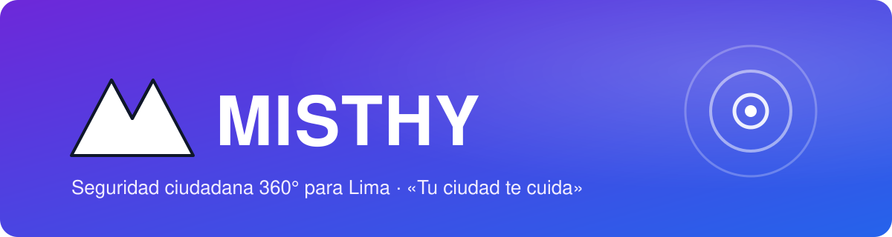

<div align="center">



<a href="https://github.com/CODERT0PH/MISTHY-">
  
</a>

<p>
  
  
  
</p>
<p>
  <a href="https://www.figma.com/design/MNhixqFUFzjBqxVnzp5dTJ"></a>
  
  
  
</p>

<p>
  <a href="#-qué-es-misthy">Qué es</a> ·
  <a href="#-ecosistema">Ecosistema</a> ·
  <a href="#-stack-tecnológico">Stack</a> ·
  <a href="#-documentación">Documentación</a> ·
  <a href="#-diseño">Diseño</a> ·
  <a href="#-autor">Autor</a>
</p>

</div>

---

## 🌋 Qué es MISTHY

**MISTHY** es un SaaS de seguridad ciudadana 360° para Lima, con piloto en **Villa El Salvador**. Une una app móvil para el ciudadano, **Misthy Web** para recuperar el control tras un robo y **Misthy Command**, el dashboard para municipalidades y serenazgo. No es otra app de botón de pánico: es la capa de datos y respuesta en tiempo real entre ciudadano, comunidad y autoridades.

<table>
  <tr>
    <td align="center" width="25%">📱<br/><b>Robo al paso</b><br/><sub>Rastreo persistente por red Mesh, alarma, bloqueo y wipe remoto</sub></td>
    <td align="center" width="25%">🔐<br/><b>Asalto con coacción</b><br/><sub>PIN de coacción que abre una bóveda señuelo y alerta en silencio</sub></td>
    <td align="center" width="25%">🚶‍♀️<br/><b>Persecución y acoso</b><br/><sub>Falso Acompañante con IA y rutas a Puntos Misthy</sub></td>
    <td align="center" width="25%">⚖️<br/><b>Impunidad</b><br/><sub>Expediente probatorio PDF listo para la comisaría</sub></td>
  </tr>
</table>

## 🧩 Ecosistema

| Producto | Para quién | Qué hace |
|---|---|---|
| 📱 **Misthy App** | Ciudadano | Mapa Vivo, Pánico, Viaje Seguro, Anti-Robo, PIN de Coacción, Bóveda, Comunidad y Falso Acompañante (módulos M1–M8) |
| 🌐 **Misthy Web** | Ciudadano sin su celular | Acceso de emergencia con correo + LLAVE MISTHY, rastreo en vivo, Lockdown, sirena, alerta PNP y aviso a contactos |
| 🛰️ **Misthy Command** | Municipalidades y serenazgo (B2B/B2G) | Monitor en vivo, analítica e IA, gestión comunitaria, integración PNP y administración |

```text
Misthy App (Flutter) ──┐
Misthy Web (Vue) ──────┼─► API REST (Node.js) ─► SQL Server (usuarios, suscripciones, pagos)
Misthy Command (Vue) ──┘        └──► Firebase / Supabase (tiempo real)
```

## 🧰 Stack tecnológico

<div align="center">

<a href="https://skillicons.dev"></a>


</div>

## 📚 Documentación

| Capítulo | Contenido |
|---|---|
| [Capítulo I · Introducción](docs/capitulo-1/README.md) | 1.1 Startup Profile · 1.2 Solution Profile (problemática, Lean UX) · 1.3 Segmentos objetivo |
| [Capítulo II · Requirements Elicitation & Analysis](docs/capitulo-2/README.md) | 2.1 Competidores · 2.2 Entrevistas · 2.3 Needfinding · 2.4 EventStorming · 2.5 Ubiquitous Language |
| [Capítulo III · Requirements Specification](docs/capitulo-3/README.md) | 3.1 User Stories · 3.2 Impact Mapping · 3.3 Product Backlog |
| [Capítulo IV · Product Design](docs/capitulo-4/README.md) | 4.1 Style Guidelines · 4.2 Information Architecture · 4.3 Landing Page UI Design · 4.4 Web Applications UX/UI Design · 4.5 Web Applications Prototyping |

Los capítulos comparten las mismas personas (Lucía Rojas, Carlos Mendoza y Rosa Huamán), los mismos user goals (UF1–UF6) y los mismos módulos (M1–M8 de la app, Misthy Web y Misthy Command).

## 🎨 Diseño

<div align="center">
  
</div>

Los diseños viven en Figma: [MISTHY · Capítulo IV Product Design](https://www.figma.com/design/MNhixqFUFzjBqxVnzp5dTJ). Los tokens para desarrollo están en [`docs/capitulo-4/tokens.css`](docs/capitulo-4/tokens.css).

| Token | Color | Uso |
|---|---|---|
| `--brand-primary` |  | Marca, botones principales |
| `--brand-secondary` |  | Acentos, enlaces, gradiente |
| `--neutral-night` |  | Texto principal, fondos oscuros |
| `--surface-lavender` |  | Superficies suaves |
| `--status-emergency` |  | Alertas y pánico (siempre con texto e ícono) |

Tipografía: **Manrope** · Espaciado en base 4 · Radios de 8, 12 y 16 px.

## 📂 Estructura del repositorio

```text
MISTHY-/
├── README.md
└── docs/
    ├── assets/          # banner del README
    ├── capitulo-1/      # Introducción
    ├── capitulo-2/      # Requirements Elicitation & Analysis
    ├── capitulo-3/      # Requirements Specification
    └── capitulo-4/      # Product Design (imágenes y tokens.css)
```

## 👤 Autor

<div align="center">

<a href="https://github.com/CODERT0PH"></a>

<br/><br/>


<br/>

<sub>Hecho en Lima por <b>CODERT0PH</b> · © 2026 MISTHY</sub>

</div>
