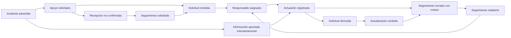

# Capítulo II: Requirements Elicitation & Analysis

**Autor:** Christoper Steven Rivas Castillo — **CODERT0PH**. **Proyecto personal:** MISTHY. **Versión:** 0.1.0. **Fecha:** 9 de octubre de 2026.

[Capítulo I](https://github.com/CODERT0PH/MISTHY-/blob/feature-capitulo1/docs/capitulo-1/README.md) · [Capítulo III](https://github.com/CODERT0PH/MISTHY-/blob/feature-capitulo3/docs/capitulo-3/README.md)

Este capítulo distingue investigación documental, decisiones de producto e hipótesis de usuarios. No se han proporcionado entrevistas. Por tanto, no se presentan transcripciones, porcentajes, fotografías ni testimonios ficticios. El PDF universitario se usa como guía metodológica; no se afirma haber ejecutado talleres de equipo ni elaborado artefactos en UXPressia o Figma.

## Contenido

- [2.1. Competidores](#competidores)
  - [2.1.1. Análisis competitivo](#analisis-competitivo)
  - [2.1.2. Estrategias y tácticas](#estrategias)
- [2.2. Entrevistas](#entrevistas)
  - [2.2.1. Diseño](#diseno-entrevistas)
  - [2.2.2. Registro](#registro-entrevistas)
  - [2.2.3. Análisis](#analisis-entrevistas)
- [2.3. Needfinding](#needfinding)
  - [2.3.1. User Personas](#personas)
  - [2.3.2. User Task Matrix](#task-matrix)
  - [2.3.3. User Journey Mapping](#journeys)
  - [2.3.4. Empathy Mapping](#empathy)
- [2.4. Big Picture EventStorming](#eventstorming)
- [2.5. Ubiquitous Language](#lenguaje)
- [Referencias y validaciones pendientes](#referencias)

## 2.1. Competidores

Se comparan **Prey**, **Life360** y **Google Find Hub / Localizador** como alternativas parciales. Compiten en protección de dispositivos, redes personales o recuperación, pero no se presupone que su alcance incluya seguimiento de extorsiones en Perú. La oportunidad de MISTHY se formula como una hipótesis de continuidad entre apoyo, registro privado y seguimiento; no como exclusividad demostrada.

### 2.1.1. Análisis competitivo

**Pregunta:** ¿qué valor puede aportar MISTHY a una persona y a un coordinador local que ya disponen de herramientas para localizar dispositivos o compartir ubicación?

| Dimensión | MISTHY — propuesta | Prey [C1, C2] | Life360 [C3, C4] | Google Find Hub [C5] |
|---|---|---|---|---|
| Overview | Registro privado de incidentes, apoyo y seguimiento local. | Protección y gestión remota de dispositivos. | Coordinación y ubicación entre círculos personales. | Localización y protección de dispositivos Android. |
| Valor principal | Continuidad del caso y claridad sobre actuaciones. | Ubicación, reportes de pérdida y acciones remotas. | Ubicación compartida y alertas SOS a contactos. | Encontrar, hacer sonar, marcar como perdido o borrar un dispositivo compatible. |
| Mercado objetivo | Adultos y responsables de organizaciones locales; piloto VES. | Personas, empresas y educación. | Familias y círculos de confianza. | Usuarios del ecosistema Android. |
| Marketing observado | Por validar: demostraciones a organizaciones y contenido educativo del fundador. | Sitio comercial, comparación de planes y demostraciones. | Sitio de planes con beneficios familiares. | Ayuda oficial e integración con la cuenta Google. |
| Productos y servicios | Web adaptable, recuperación de cuenta y Command; app futura. | Seguimiento, alarma y bloqueo según plan y sistema operativo. | Historial, avisos de lugares y SOS según plan y disponibilidad. | Aplicación y acceso desde navegador; ubicación reciente o última conocida. |
| Precios y costos | Freemium y suscripción organizacional por validar. | Starter anunciado a USD 2.99/mes para cinco dispositivos; impuestos aparte. | Planes Free, Silver y Gold; no se confirma una tarifa local para Perú. | La página de soporte consultada no especifica una suscripción; no se infiere precio de hardware. |
| Distribución | Web; móvil en evolución futura. | Agente instalado y panel remoto. | Aplicaciones móviles. | Web y aplicación Android. |

Precios y características consultados el 09/10/2026; pueden cambiar. Las capacidades de un competidor no son permisos disponibles automáticamente para MISTHY. No se afirma disponibilidad de despacho de emergencia de Life360 en Perú. Los logos no se recrean ni se presentan como propios; la comparación utiliza los nombres y enlaces oficiales.

#### SWOT — interpretación de producto

El siguiente análisis es una inferencia del autor a partir del alcance documentado y de la propuesta MISTHY, no información interna de las empresas.

| Factor | MISTHY | Prey | Life360 | Google Find Hub |
|---|---|---|---|---|
| Fortalezas | Enfoque local y trazabilidad diseñada alrededor del incidente. | Especialización en dispositivos. | Experiencia centrada en círculos personales. | Integración con Android. |
| Debilidades | Sin usuarios validados, convenios ni operación continua; un desarrollador. | Dependencia de instalación, conexión y capacidades del sistema. | Dependencia de participación del círculo y cobertura de funciones. | Dependencia del ecosistema, configuración y condiciones del equipo. |
| Oportunidades | Organizaciones pequeñas que necesitan ordenar atención y seguimiento. | Demanda de protección de equipos. | Necesidad de coordinación familiar. | Extensión de recuperación dentro de su ecosistema. |
| Amenazas | Filtraciones, falsas expectativas, falta de confianza y costos de operación. | Funciones integradas de los sistemas operativos. | Abandono por preocupaciones de privacidad. | Expectativas excesivas de recuperación y problemas de acceso a cuenta. |

El hallazgo documental es que **localizar un objeto, avisar a contactos y seguir un incidente son tareas diferentes**. La diferenciación propuesta debe comprobarse con usuarios; no basta con acumular funciones.

### 2.1.2. Estrategias y tácticas frente a competidores

| Estrategia | Táctica | Señal para decidir |
|---|---|---|
| Enfocarse en continuidad del incidente. | Probar registro privado, responsable y cronología antes de funciones antirrobo avanzadas. | Éxito y comprensión de tareas H03/H04 del capítulo I. |
| Complementar herramientas existentes. | Explicar diferencia entre recuperar la cuenta MISTHY y bloquear un equipo; facilitar orientación verificable. | El participante identifica qué acción sí ejecuta MISTHY. |
| Construir confianza con límites explícitos. | Mostrar pendiente, entregado y confirmado por separado; indicar origen y antigüedad. | Comprensión de estados en H02 y ausencia de afirmaciones falsas. |
| Mantener acceso esencial. | No priorizar alertas por pago; validar ingresos con herramientas organizacionales. | Comprensión del modelo y aceptación de dos organizaciones. |
| Reducir exposición. | Extorsiones privadas, acceso por consentimiento y exportación revisable. | No aparecen datos privados en mapas o accesos no autorizados. |
| Empezar con capacidad real. | Un sector, horarios declarados y soporte acotado. | Carga de moderación y costo por usuario medidos antes de escalar. |

## 2.2. Entrevistas

**Objetivo:** comprender cómo se pide apoyo y se da seguimiento hoy, qué barreras generan abandono y qué información se considera demasiado sensible para compartir. Se explora también la percepción de trato desigual sin inducir una respuesta ni afirmar que todos los agentes actúan igual.

### 2.2.1. Diseño de entrevistas

Muestreo intencional exploratorio: 3–5 adultos por segmento S1 y S2, inicialmente 6–10 entrevistas. No es una muestra representativa de Perú. Reclutar variedad de habilidades digitales y experiencias de coordinación; una misma persona no se cuenta dos veces en el total de participantes únicos. Si tiene dos roles, se etiqueta el rol analizado.

Duración orientativa: 25–35 minutos. Explicar finalidad, voluntariedad, uso de datos y posibilidad de omitir preguntas. Solicitar permiso específico para grabar. No pedir nombres de presuntos delincuentes, números privados, detalles gráficos ni copias de amenazas reales. Evitar reclutar personas en una emergencia activa. La investigación no constituye asesoría ni un canal de atención.

| Bloque común | Pregunta principal | Profundización no inductiva | Dato buscado |
|---|---|---|---|
| Contexto | ¿Cómo es una semana habitual de trabajo o estudio para ti? | ¿Por qué zonas te desplazas y con qué frecuencia? | Rol, movilidad y contexto. |
| Tecnología | ¿Qué dispositivos utilizas para comunicarte? | ¿Qué navegador, conectividad o dificultad de lectura encuentras? | Dispositivo, canal, accesibilidad. |
| Apoyo | ¿A quién recurres cuando necesitas ayuda? | ¿Cómo acuerdan que esa persona puede participar? | Red real y consentimiento. |
| Confianza | ¿Qué te ayuda a confiar en un servicio que guarda información personal? | ¿Qué información preferirías no registrar y por qué? | Límites y expectativas. |
| Influencias | ¿Qué medios o personas consultas para decidir qué herramienta usar? | ¿Hay servicios que hayas dejado de utilizar? | Influencias y experiencias. |

**Guion S1 — Ciudadano adulto**

| ID | Pregunta principal | Complementaria |
|---|---|---|
| Q1 | Sin entrar en detalles que te incomoden, ¿recuerdas una situación en que necesitaste apoyo por inseguridad? | ¿Qué hiciste primero y por qué? |
| Q2 | ¿Cómo supiste si tu solicitud llegó a alguien? | ¿Qué hiciste cuando no recibiste respuesta? |
| Q3 | ¿Dónde guardaste fechas, mensajes o constancias? | ¿Pudiste encontrarlos cuando los necesitaste? |
| Q4 | ¿Cómo seguiste las gestiones después de pedir ayuda? | ¿Qué información faltaba o era difícil de entender? |
| Q5 | ¿Qué dificultades encontraste al buscar atención? | ¿Influyeron tiempo, dinero, traslado, idioma o acceso a orientación? |
| Q6 | ¿Qué hace que una persona decida no reportar una amenaza? | ¿Cómo influye el temor a que se conozca su identidad? |
| Q7 | Si pierdes acceso al celular, ¿qué alternativas tienes para comunicarte? | ¿Tienes acceso a otro equipo o recuerdas tus credenciales? |
| Q8 | ¿Qué diferencia esperas entre enviar una alerta y presentar una denuncia formal? | ¿Cómo te gustaría reconocer quién recibió cada una? |
| Q9 | ¿Qué resultado te haría considerar útil una herramienta de apoyo? | ¿Qué no debería prometerte? |

**Guion S2 — Responsable local**

| ID | Pregunta principal | Complementaria |
|---|---|---|
| Q10 | ¿Cómo llega actualmente un aviso a tu organización? | ¿Qué canales y horarios atienden realmente? |
| Q11 | ¿Qué información necesitas para decidir la siguiente acción? | ¿Qué haces si falta información o el aviso es duplicado? |
| Q12 | ¿Cómo asignan una persona responsable? | ¿Cómo transfieren el seguimiento entre turnos? |
| Q13 | ¿Cómo distinguen una solicitud recibida de una acción realizada? | ¿Dónde queda constancia y quién puede corregirla? |
| Q14 | ¿Qué información comparten con terceros? | ¿Cómo obtienen permiso y evitan divulgar identidades? |
| Q15 | ¿Qué hacen cuando una solicitud sigue sin respuesta? | ¿Quién decide el escalamiento y qué canales verifican? |
| Q16 | ¿Cómo podría evaluar tu organización una herramienta nueva? | ¿Quién decide, qué presupuesto existe y qué evidencia necesitaría? |
| Q17 | ¿Qué reglas utilizan para priorizar solicitudes? | ¿Qué controles evitarían un trato distinto por pago o relación personal? |

Al cierre: resumir lo comprendido, preguntar si se interpretó correctamente y solicitar permiso separado para un contacto posterior. Edad exacta, género, estado civil y situación familiar son opcionales y solo se recogen si aportan a la investigación. En la publicación se usan códigos y rangos, no datos que permitan identificar a una víctima.

### 2.2.2. Registro de entrevistas

**Entrevistas realizadas y aportadas a esta versión: 0.** La siguiente tabla es el registro de reclutamiento previsto, no evidencia de ejecución.

| Código | Segmento | Estado | Fecha / duración | Evidencia consentida | Resumen |
|---|---|---|---|---|---|
| S1-01 | Ciudadano | Por reclutar | No disponible | No disponible | Sin datos |
| S1-02 | Ciudadano | Por reclutar | No disponible | No disponible | Sin datos |
| S1-03 | Ciudadano | Por reclutar | No disponible | No disponible | Sin datos |
| S2-01 | Coordinador | Por reclutar | No disponible | No disponible | Sin datos |
| S2-02 | Coordinador | Por reclutar | No disponible | No disponible | Sin datos |
| S2-03 | Coordinador | Por reclutar | No disponible | No disponible | Sin datos |

Para cada entrevista se registrará: código, segmento, fecha, consentimiento, perfil pertinente, contexto, tareas narradas, obstáculos, dispositivos/canales, objetivos, frustraciones, citas autorizadas con minuto, interpretación del investigador y observaciones contradictorias. Grabaciones e identidades se conservan en almacenamiento privado; no se suben automáticamente al repositorio público. Se adjunta una [ficha reutilizable](ficha-entrevista.md).

### 2.2.3. Análisis de entrevistas

Procedimiento previsto: transcribir o resumir con marcas de tiempo; codificar por tema; agrupar por segmento; buscar coincidencias y casos negativos; revisar interpretaciones con el participante cuando sea posible; actualizar personas y requisitos.

| Código temático | Definición operacional | Evidencia necesaria | Requisito candidato |
|---|---|---|---|
| N01 — Continuidad | Dificultad narrada para conocer la próxima acción o responsable. | Relato y momento donde se interrumpe el seguimiento. | Cronología y responsable. |
| N02 — Privacidad | Reticencia a revelar información por exposición o represalias. | Preferencias expresas y contexto. | Registro privado y permisos. |
| N03 — Acceso | Pérdida de acceso al teléfono o credenciales. | Alternativas utilizadas y barreras. | Recuperación desde otro dispositivo. |
| N04 — Comprensión | Confusión entre envío, recepción y actuación. | Explicación del participante. | Estados diferenciados. |
| N05 — Equidad | Obstáculos vinculados a recursos, trato, tiempo o contactos. | Experiencia atribuida sin generalizar a toda una institución. | Funciones esenciales gratuitas y prioridad por riesgo. |
| N06 — Organización | Información dispersa o duplicada. | Ejemplos anonimizados del proceso. | Registro unificado, exportación y deduplicación. |

Para cada característica se informará `n/N × 100`, con N igual al número de respuestas válidas del segmento para esa pregunta, sin contar omisiones como respuestas negativas. Si N=0 se registra «sin datos». Las respuestas múltiples no tienen por qué sumar 100 %. Los porcentajes describirán únicamente la muestra entrevistada; hoy no hay porcentajes que reportar.

## 2.3. Needfinding

Los siguientes artefactos son **proto-personas y mapas hipotéticos** derivados de la visión del fundador y la investigación documental. Son material para contrastar, no hallazgos de entrevistas. Cada atributo deberá vincularse a códigos S1-xx/S2-xx antes de presentarse como validado.

### 2.3.1. User Personas — versiones preliminares

| Campo | P1 — Ciudadano que necesita continuidad | P2 — Responsable de coordinación local |
|---|---|---|
| Segmento | S1. | S2. |
| Contexto | Adulto residente o usuario frecuente del sector piloto. | Adulto con rol de coordinación autorizado en una organización del sector. |
| Objetivo | Pedir apoyo y conservar control de su información después de un incidente. | Saber qué solicitudes siguen pendientes y quién actúa sobre ellas. |
| Tareas | Contactar a alguien, ordenar fechas, pedir orientación y seguir gestiones. | Recibir, aclarar, asignar, registrar actuaciones y comunicar avances. |
| Frustraciones hipotéticas | Repetir el relato, desconocer el estado, perder el dispositivo o exponer su identidad. | Avisos incompletos, duplicados y traspasos sin contexto. |
| Beneficio esperado | Claridad y privacidad, incluso con un equipo prestado. | Continuidad sin prometer una respuesta que no controla. |
| Canales por validar | Llamadas, mensajería, navegador propio o prestado. | Mensajería, llamadas y registros administrativos. |
| Accesibilidad | Verificar lectura, idioma, conectividad, destreza y tecnologías de apoyo. | Verificar carga de trabajo, tamaño de pantalla y necesidades de lectura. |
| Datos no conocidos | Edad exacta, género, familia, ingresos, marcas, personalidad y biografía. | Edad exacta, organización, presupuesto, turnos y experiencia. |
| Estado | Hipótesis; sin foto ni cita atribuida a persona real. | Hipótesis; sin foto ni cita atribuida a persona real. |

### 2.3.2. User Task Matrix

Se comparan tareas que existen sin MISTHY. Frecuencia: D diaria, S semanal, E ante un evento, V por validar. Importancia propuesta: A alta, M media. Todos los valores son estimaciones iniciales del investigador, no mediciones.

| Tarea | P1 frecuencia | P1 importancia | P2 frecuencia | P2 importancia |
|---|---|---|---|---|
| Identificar a quién pedir apoyo. | E | A | E | A |
| Describir un incidente con fecha y lugar. | E | A | E | A |
| Confirmar si alguien recibió la solicitud. | E | A | E | A |
| Organizar mensajes y constancias. | E | A | V | A |
| Asignar una persona responsable de seguimiento. | E | M | V | A |
| Consultar qué gestión sigue pendiente. | E | A | V | A |
| Compartir solo la información necesaria. | E | A | V | A |
| Consultar avisos del entorno. | V | M | V | M |

Coinciden la necesidad de comprender el estado y limitar la información compartida. La coordinación tiene una responsabilidad adicional de asignación y continuidad entre personas. La frecuencia real no puede deducirse de noticias ni del rol supuesto.

### 2.3.3. User Journey Mapping — As-Is hipotéticos

**P1: desde una amenaza hasta buscar continuidad de atención, sin MISTHY.**

| Etapa | Acción actual hipotética | Canal | Fricción a investigar | Emoción hipotética | Oportunidad |
|---|---|---|---|---|---|
| Percibir el incidente | Reconoce una amenaza o pérdida. | Entorno o mensajes. | Incertidumbre sobre urgencia. | Temor. | Orientación comprensible. |
| Pedir apoyo | Contacta a una persona o entidad. | Llamada o visita. | No sabe si alguien recibió el pedido. | Ansiedad. | Confirmación diferenciada. |
| Reunir información | Busca fechas, mensajes y documentos. | Archivos y conversaciones. | Información fragmentada. | Agobio. | Cronología privada. |
| Seguir la gestión | Vuelve a consultar por avances. | Llamada o visita. | No identifica responsable o próxima acción. | Frustración. | Historial con fuente y estado. |
| Continuar su actividad | Decide cómo preservar información y apoyo. | Red personal. | Temor a exposición. | Cautela. | Control de acceso y cierre voluntario. |

**P2: desde recibir un aviso hasta transferir o cerrar el seguimiento, sin MISTHY.**

| Etapa | Acción actual hipotética | Canal | Fricción a investigar | Emoción hipotética | Oportunidad |
|---|---|---|---|---|---|
| Recibir | Escucha o lee una solicitud. | Llamada o mensaje. | Avisos incompletos. | Preocupación. | Datos mínimos claros. |
| Comprender | Solicita contexto pertinente. | Conversación. | Repetición y duplicidad. | Presión. | Relación entre registros. |
| Coordinar | Busca a quien pueda apoyar. | Contactos. | Disponibilidad incierta. | Urgencia. | Responsable y límites visibles. |
| Dar seguimiento | Anota actuaciones y consulta pendientes. | Notas o mensajes. | Traspaso sin contexto. | Sobrecarga. | Cronología consistente. |
| Cerrar o escalar | Comunica qué se hizo y qué falta. | Conversación o constancia. | Confundir cierre interno con resolución oficial. | Incertidumbre. | Motivo de cierre y evidencia. |

**As-Is Scenario Map complementario:** P1 hace llamadas y reúne información, piensa cómo protegerse y podría sentir incertidumbre; P2 recibe, pregunta y coordina, piensa qué puede hacer con sus recursos y podría sentir presión. Son hipótesis de Doing/Thinking/Feeling que se reemplazarán por observaciones consentidas.

### 2.3.4. Empathy Mapping — hipótesis

| Dimensión | P1 | P2 |
|---|---|---|
| Con quién se empatiza | Adulto que busca apoyo sin perder control de información. | Adulto responsable de coordinar dentro de recursos limitados. |
| Qué necesita hacer | Pedir ayuda, ordenar hechos y seguir gestiones. | Comprender, priorizar, asignar y comunicar actuaciones. |
| Qué ve | Posibles canales e información dispersa; por validar. | Posibles avisos simultáneos y registros separados; por validar. |
| Qué dice | Sin citas disponibles; preguntar qué respuesta considera suficiente. | Sin citas disponibles; preguntar qué necesita para hacerse cargo. |
| Qué hace | Hipótesis: busca contactos y conserva mensajes. | Hipótesis: consulta a otros y anota avances. |
| Qué escucha | Investigar recomendaciones y advertencias de su entorno. | Investigar indicaciones de responsables y expectativas de vecinos. |
| Qué piensa y siente | Hipótesis: temor a exposición e incertidumbre sobre respuesta. | Hipótesis: presión por responder sin información suficiente. |
| Pains | Exposición, barreras de acceso, repetición y falta de seguimiento. | Duplicidad, responsabilidad difusa y falta de recursos. |
| Gains | Control, claridad y continuidad. | Priorización justificable y registro de actuaciones. |

## 2.4. Big Picture EventStorming

Modelo preliminar individual del dominio. No se ha celebrado una sesión colaborativa. Se documentan los eventos en pasado y los puntos de incertidumbre para discutirlos con representantes de ambos segmentos. Es análisis del negocio, no arquitectura del capítulo IV.

**Etapa 1 — Exploración:** amenaza recibida, incidente advertido, apoyo solicitado, solicitud recibida, información aportada, responsable asignado, actuación registrada, solicitud derivada, actualización recibida y seguimiento cerrado.

**Etapa 2 — Orden temporal y bifurcaciones:** una solicitud puede existir sin adjuntos; la recepción no garantiza atención; el seguimiento puede permanecer pendiente y reabrirse. El ciudadano decide si comparte información sensible.

**Etapa 3 — Actores y reglas de negocio:**

| Actor | Actuación | Regla propuesta |
|---|---|---|
| Ciudadano | Solicita apoyo y aporta información. | Mantiene control de sus autorizaciones; puede pedir ayuda sin adjuntar archivos. |
| Contacto de confianza | Acepta participar y acusa recibo. | Recibir un mensaje no significa aceptar hacerse cargo ni ser autoridad. |
| Coordinador | Asigna y registra actuaciones. | Solo accede al ámbito autorizado; no declara resuelto un proceso judicial. |
| Moderador | Evalúa avisos comunitarios. | No publica datos de extorsión, identidades ni acusaciones individuales. |
| Entidad externa | Puede recibir una gestión por un canal independiente. | Solo se registra su respuesta si existe evidencia y se identifica su origen. |

**Etapa 4 — Hotspots y oportunidades:**

| Hotspot | Riesgo | Pregunta pendiente | Consecuencia para requisitos |
|---|---|---|---|
| Recepción sin actuación | Falsa sensación de ayuda. | ¿Cómo se acredita cada estado? | Separar entrega, lectura y actuación. |
| Temor a represalias | Exposición de personas. | ¿Quién necesita ver qué datos? | Extorsión privada y permisos revocables. |
| Denuncia formal | Confundir registro interno con acto oficial. | ¿Qué constancia dispone el ciudadano? | Referencia externa con procedencia. |
| Información contradictoria | Acusación o cierre incorrecto. | ¿Cómo se corrige conservando historial? | Correcciones con autor, fecha y motivo. |
| Falta de respuesta | Abandono y frustración. | ¿Qué plazo y canal son apropiados? | Recordatorios configurables, sin promesa de despacho. |
| Prioridad por recursos | Trato desigual. | ¿Qué criterios de riesgo se acuerdan? | Prioridad justificada, sin usar plan de pago. |

La validación debe revisar estos eventos con participantes; una exportación visual no sustituye esa validación.

## 2.5. Ubiquitous Language

| Término de dominio | Definición acordada para la propuesta |
|---|---|
| Citizen (ciudadano) | Persona adulta que solicita apoyo o conserva información de un incidente. |
| Incident (incidente) | Situación reportada que afecta o puede afectar la seguridad; no implica delito probado. |
| Threat (amenaza) | Comunicación o conducta que el reportante percibe como intimidación; se conserva como relato atribuido. |
| Suspected Extortion (presunta extorsión) | Incidente descrito como amenaza asociada a una exigencia; su clasificación en MISTHY no es una determinación jurídica. |
| Support Request (solicitud de apoyo) | Petición dirigida a una red autorizada; distinta de denuncia formal. |
| Trusted Contact (contacto de confianza) | Persona que acepta participar en la red designada por el ciudadano. |
| Acknowledgment (acuse de recibo) | Confirmación de recepción; no prueba atención o resolución. |
| Local Coordinator (coordinador local) | Responsable autorizado para organizar seguimiento dentro de una organización. |
| Follow-up (seguimiento) | Conjunto de consultas y actuaciones posteriores a una solicitud. |
| Case Timeline (cronología del caso) | Secuencia de hechos relatados y actuaciones con fechas y fuentes diferenciadas. |
| Formal Complaint (denuncia formal) | Comunicación registrada ante una entidad competente por sus canales; no se crea automáticamente al reportar en MISTHY. |
| External Reference (referencia externa) | Identificador o constancia de una gestión externa aportada con su procedencia. |
| Supporting Material (material de respaldo) | Archivo aportado voluntariamente; no se presume auténtico ni admisible judicialmente. |
| Disclosure Permission (permiso de divulgación) | Autorización de acceso delimitada por persona, alcance y vigencia. |
| Community Notice (aviso comunitario) | Información moderada y minimizada que puede publicarse sobre el entorno. |
| Severity (severidad) | Nivel de atención operativa propuesto según criterios de riesgo, no según capacidad económica. |
| Referral (derivación) | Traslado documentado de una solicitud por un canal identificado. |
| Internal Closure (cierre interno) | Fin del seguimiento en MISTHY con motivo; no equivale a sentencia o resolución del delito. |
| Reopening (reapertura) | Continuación del seguimiento por información nueva o necesidad pendiente. |
| Last Known Location (última ubicación conocida) | Ubicación recibida con fecha y precisión; no garantiza ubicación actual. |

## Referencias y validaciones pendientes

- **C1.** Prey. (s. f.). *Pricing*. Consulta: 09/10/2026. https://preyproject.com/pricing
- **C2.** Prey. (s. f.). *How does Prey work*. Consulta: 09/10/2026. https://help.preyproject.com/article/195-how-does-prey-work
- **C3.** Life360. (s. f.). *International plans & pricing*. Consulta: 09/10/2026. https://intl.life360.com/plans-pricing
- **C4.** Life360. (s. f.). *SOS Alerts*. Consulta: 09/10/2026. https://support.life360.com/hc/en-us/articles/23053474049687-SOS-Alerts
- **C5.** Google. (s. f.). *Encontrar, bloquear o borrar los datos de un dispositivo Android perdido*. Consulta: 09/10/2026. https://support.google.com/android/answer/6160491?hl=es

**Para cerrar la investigación:** reclutar participantes, ejecutar y registrar entrevistas consentidas, analizar respuestas y contradicciones, sustituir proto-personas por perfiles sustentados y validar el modelo del dominio. Esta versión sí entrega los instrumentos y análisis documental; no declara completado el trabajo de campo.
