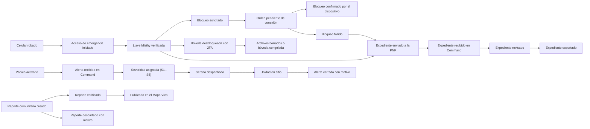

# Capítulo II: Requirements Elicitation & Analysis

**Autor:** Christoper Steven Rivas Castillo — [CODERT0PH](https://github.com/CODERT0PH). **Proyecto personal:** MISTHY. **Versión:** 0.2.0. **Fecha:** 10 de octubre de 2026.

[Capítulo I](../capitulo-1/README.md) · [Capítulo III](../capitulo-3/README.md) · [Capítulo IV](../capitulo-4/README.md)

Este capítulo analiza la competencia, define cómo se entrevistará a los usuarios y modela a las personas, sus tareas y el dominio. Las **user personas** son las mismas que usa el capítulo IV en sus wireflows y user flows: **Lucía Rojas** (ciudadana), **Carlos Mendoza** (operador de serenazgo) y **Rosa Huamán** (supervisora de gestión comunitaria). Mientras no existan entrevistas registradas, se presentan como proto-personas: sus atributos se confirmarán o corregirán con el trabajo de campo de 2.2.

## Contenido

- [2.1. Competidores](#competidores)
  - [2.1.1. Análisis competitivo](#analisis-competitivo)
  - [2.1.2. Estrategias y tácticas](#estrategias)
- [2.2. Entrevistas](#entrevistas)
  - [2.2.1. Diseño](#diseno-entrevistas)
  - [2.2.2. Registro](#registro-entrevistas)
  - [2.2.3. Análisis](#analisis-entrevistas)
- [2.3. Needfinding](#needfinding)
  - [2.3.1. User Personas](#personas)
  - [2.3.2. User Task Matrix](#task-matrix)
  - [2.3.3. User Journey Mapping](#journeys)
  - [2.3.4. Empathy Mapping](#empathy)
  - [2.3.5. User Goals](#user-goals)
- [2.4. Big Picture EventStorming](#eventstorming)
- [2.5. Ubiquitous Language](#lenguaje)
- [Referencias y validaciones pendientes](#referencias)

## 2.1. Competidores

Se comparan **Prey**, **Life360** y **Google Find Hub / Localizador**. Cada uno cubre una parte de lo que hace MISTHY (protección del dispositivo, círculo familiar o localización), pero ninguno conecta al ciudadano con el serenazgo y la comisaría de su sector ni ofrece un panel para la municipalidad.

### 2.1.1. Análisis competitivo

**Pregunta:** ¿qué valor aporta MISTHY a Lucía, que ya puede localizar su teléfono con Google, y a la municipalidad de Carlos y Rosa, que ya recibe llamadas al serenazgo?

| Dimensión | MISTHY | Prey [C1, C2] | Life360 [C3, C4] | Google Find Hub [C5] |
|---|---|---|---|---|
| Overview | Seguridad ciudadana 360°: app (M1–M8), Misthy Web para recuperar el equipo y Misthy Command para el serenazgo. | Protección y gestión remota de dispositivos. | Ubicación compartida y alertas en círculos familiares. | Localización y protección de dispositivos Android. |
| Valor principal | Del robo a la comisaría: bloquear, ubicar, proteger la bóveda, avisar a contactos y enviar el expediente a la PNP; despacho del sereno más cercano. | Ubicación, reportes de pérdida y acciones remotas. | Ubicación compartida y SOS a contactos. | Encontrar, hacer sonar, bloquear o borrar un dispositivo compatible. |
| Mercado objetivo | Ciudadanos de Lima (piloto VES), juntas vecinales, universidades y municipalidades. | Personas, empresas y educación. | Familias. | Usuarios de Android. |
| Marketing | Landing `misthy.pe` con rutas por audiencia, demos a municipalidades y contenido educativo del fundador. | Sitio comercial y demos. | Sitio de planes con beneficios familiares. | Ayuda oficial integrada a la cuenta Google. |
| Productos y servicios | Mapa Vivo, Pánico, Viaje Seguro, Anti-Robo con Red Mesh, PIN de Coacción, Bóveda, Comunidad, Falso Acompañante; panel de recuperación web; monitor, despacho, reportes, expedientes y analítica. | Seguimiento, alarma y bloqueo según plan. | Historial, avisos de lugares y SOS según plan. | App y web; ubicación reciente o última conocida. |
| Precios | Free / Pro S/ 9.90–14.90; Organizaciones S/ 150–3 000; Command S/ 4 500–8 500 por distrito (referenciales). | Starter USD 2.99/mes para cinco dispositivos. | Free, Silver y Gold. | Sin suscripción. |
| Distribución | App móvil, web y panel B2G. | Agente instalado y panel. | Apps móviles. | Web y app Android. |

Precios consultados el 09/10/2026; pueden cambiar. No se afirma que Life360 ofrezca despacho de emergencia en Perú.

#### SWOT

Inferencia del autor a partir de la información pública de cada producto.

| Factor | MISTHY | Prey | Life360 | Google Find Hub |
|---|---|---|---|---|
| Fortalezas | Enfoque local, conexión con serenazgo y PNP, recuperación desde navegador prestado, expediente probatorio. | Especialización en dispositivos. | Comunidad familiar grande. | Integración nativa con Android. |
| Debilidades | Sin usuarios ni convenios aún; un solo desarrollador; límites del sistema operativo para anti-apagado. | Depende de instalación y conexión. | Depende de que el círculo participe. | Depende del ecosistema y de la cuenta Google. |
| Oportunidades | Municipalidades con presupuesto de seguridad ciudadana; juntas vecinales organizadas; alta tasa de robo de celulares. | Demanda de protección de equipos. | Coordinación familiar. | Extensión de su red de búsqueda. |
| Amenazas | Filtraciones de datos, falsas expectativas, competencia de funciones nativas del sistema. | Funciones nativas del sistema operativo. | Preocupaciones de privacidad. | Expectativas excesivas de recuperación. |

Hallazgo: **localizar un objeto, avisar a contactos y lograr que la autoridad local actúe son tareas distintas**. MISTHY se diferencia al unirlas en un solo flujo.

### 2.1.2. Estrategias y tácticas frente a competidores

| Estrategia | Táctica | Señal para decidir |
|---|---|---|
| Ganar en el momento posterior al robo. | Misthy Web con acceso por Llave Misthy desde cualquier navegador y panel de recuperación (UF1–UF3). | H05 y H09 del capítulo I. |
| Conectar con la autoridad local. | Misthy Command con cola por severidad, despacho y bandeja de expedientes (UF4, UF6). | H08 y contrato con una municipalidad. |
| Construir confianza con estados honestos. | Mostrar «Solicitud enviada → Pendiente → Confirmado / No se pudo ejecutar» en cada orden remota. | H02 y H05. |
| Diferenciarse en sin-conexión. | Red Mesh, última ubicación antes del apagado y kiosk con Llave Misthy. | H11 en fase 2. |
| Comunidad con información confiable. | Reportes verificados por supervisoras y gamificación (UF5). | H07 y H12. |
| Acceso esencial gratuito. | Pánico, acceso de emergencia, bloqueo y aviso a contactos en el plan Free. | Activación (H01) sin pago. |

## 2.2. Entrevistas

**Objetivo:** entender cómo reaccionan hoy las personas ante un robo o una amenaza, cómo las atiende el serenazgo y qué información necesita la comisaría, para validar a Lucía, Carlos y Rosa y priorizar el backlog.

### 2.2.1. Diseño de entrevistas

Muestreo intencional: 3–5 personas por cada persona objetivo (ciudadanos; operadores de serenazgo; supervisores comunitarios o coordinadores de junta vecinal), entre 9 y 15 entrevistas. Duración de 25–35 minutos. Se explica la finalidad, se pide consentimiento y un permiso aparte para grabar. No se piden nombres de presuntos delincuentes, números privados ni detalles gráficos. No se entrevista a personas en una emergencia activa.

| Bloque común | Pregunta principal | Profundización | Dato buscado |
|---|---|---|---|
| Contexto | ¿Cómo es una semana habitual de trabajo o estudio para ti? | ¿Por qué zonas te desplazas y a qué horas? | Rol, movilidad, horarios. |
| Tecnología | ¿Qué dispositivos usas? | ¿Usas smartwatch? ¿Qué conectividad tienes? | Dispositivos y accesibilidad. |
| Apoyo | ¿A quién recurres cuando necesitas ayuda? | ¿Esa persona sabe que puede recibir tus alertas? | Red de confianza. |
| Confianza | ¿Qué te haría confiar en una app que guarda tu ubicación y documentos? | ¿Qué no registrarías nunca? | Límites de privacidad. |

**Guion para ciudadanos (Lucía)**

| ID | Pregunta principal | Complementaria |
|---|---|---|
| Q1 | ¿Te han robado el celular o conoces a alguien a quien le pasó? Sin detalles que te incomoden, ¿qué hicieron primero? | ¿Desde qué equipo pidieron ayuda? |
| Q2 | ¿Pudieron bloquear el equipo o proteger sus cuentas y documentos? | ¿Qué les impidió hacerlo? |
| Q3 | ¿Cómo supieron si alguien recibió su pedido de ayuda? | ¿Qué hicieron si no hubo respuesta? |
| Q4 | ¿Fueron a la comisaría? ¿Qué les pidieron? | ¿Tenían ubicación, fotos o fechas para mostrar? |
| Q5 | ¿Qué te hace sentir inseguro en un taxi, mototaxi o caminando de noche? | ¿Qué haces hoy para protegerte (compartir ubicación, llamar a alguien)? |
| Q6 | Si alguien te obliga a desbloquear tu celular, ¿qué crees que debería pasar? | ¿Usarías un PIN falso que alerte en silencio? |
| Q7 | ¿Qué hace que una persona decida no reportar una amenaza o extorsión? | ¿Cómo influye que se conozca su identidad? |
| Q8 | ¿Consultarías un mapa de zonas con robos verificados? | ¿Qué dato te haría confiar en él? |
| Q9 | ¿Qué resultado haría útil una app así? ¿Qué no debería prometerte? | ¿Pagarías por funciones extra? |

**Guion para serenazgo y gestión comunitaria (Carlos y Rosa)**

| ID | Pregunta principal | Complementaria |
|---|---|---|
| Q10 | ¿Cómo llega hoy una alerta a la central? | ¿Por qué canales y en qué horarios? |
| Q11 | ¿Cómo deciden qué alerta atender primero? | ¿Usan algún nivel de severidad? |
| Q12 | ¿Cómo eligen y avisan al sereno que va al lugar? | ¿Cómo saben dónde está cada unidad? |
| Q13 | ¿Cómo registran que la unidad llegó y cerró el caso? | ¿Dónde queda la constancia? |
| Q14 | ¿Cómo coordinan con la comisaría del sector? | ¿Qué información pide la PNP para iniciar una denuncia? |
| Q15 | ¿Reciben reportes de vecinos? ¿Cómo verifican si son reales? | ¿Qué hacen con los duplicados o falsos? |
| Q16 | ¿Qué indicadores reporta la central a la gerencia? | ¿Por hora, zona o tipo de delito? |
| Q17 | ¿Cómo evaluaría la municipalidad una herramienta nueva? | ¿Quién decide y con qué presupuesto? |

Al cierre se resume lo entendido, se pregunta si es correcto y se pide permiso separado para un contacto posterior. En la publicación se usan códigos y rangos, no datos que identifiquen a una persona.

### 2.2.2. Registro de entrevistas

**Entrevistas realizadas en esta versión: 0.** La tabla es el plan de reclutamiento.

| Código | Persona objetivo | Estado | Fecha / duración | Evidencia consentida | Resumen |
|---|---|---|---|---|---|
| CIU-01 | Lucía (ciudadana) | Por reclutar | — | — | — |
| CIU-02 | Lucía (ciudadana) | Por reclutar | — | — | — |
| CIU-03 | Lucía (ciudadana) | Por reclutar | — | — | — |
| OPE-01 | Carlos (operador de serenazgo) | Por reclutar | — | — | — |
| OPE-02 | Carlos (operador de serenazgo) | Por reclutar | — | — | — |
| SUP-01 | Rosa (supervisora comunitaria / junta vecinal) | Por reclutar | — | — | — |
| SUP-02 | Rosa (supervisora comunitaria / junta vecinal) | Por reclutar | — | — | — |

Cada entrevista se registra con la [ficha de entrevista](ficha-entrevista.md). Grabaciones e identidades se guardan en almacenamiento privado, fuera del repositorio.

### 2.2.3. Análisis de entrevistas

Se transcribe con marcas de tiempo, se codifica por tema, se agrupa por persona objetivo, se buscan coincidencias y casos que contradicen las hipótesis, y se actualizan personas y requisitos.

| Código temático | Definición | Requisito candidato |
|---|---|---|
| N01 — Continuidad | No se sabe quién atiende ni cuál es el siguiente paso. | Cronología, responsable y estado del despacho. |
| N02 — Privacidad | Reticencia a revelar información por exposición o represalias. | Registro privado, bóveda cifrada, permisos. |
| N03 — Acceso | Pérdida del celular o de credenciales. | Acceso de emergencia con Llave Misthy, bloqueo remoto. |
| N04 — Comprensión | Confusión entre enviado, recibido y ejecutado. | Estados honestos de órdenes y alertas. |
| N05 — Equidad | Barreras por recursos, trato, tiempo o contactos. | Funciones esenciales gratuitas; prioridad por severidad, no por pago. |
| N06 — Evidencia | Información dispersa al llegar a la comisaría. | Expediente probatorio PDF. |
| N07 — Respuesta | Tiempo largo entre la alerta y la llegada del sereno. | Cola por severidad y despacho al más cercano. |
| N08 — Prevención | Miedo en trayectos y zonas desconocidas. | Mapa Vivo, Viaje Seguro, Puntos Misthy, Falso Acompañante. |

Cada característica se reportará como `n/N × 100` sobre las respuestas válidas de cada grupo. Hoy no hay porcentajes que reportar.

## 2.3. Needfinding

### 2.3.1. User Personas

Las tres personas del capítulo IV. Datos demográficos y citas se completarán con las entrevistas de 2.2.

| Campo | Lucía Rojas — Ciudadana | Carlos Mendoza — Operador de serenazgo | Rosa Huamán — Supervisora de gestión comunitaria |
|---|---|---|---|
| Perfil | 32 años, vendedora en Villa El Salvador. Le robaron el celular al paso. | Operador en la central de serenazgo de la municipalidad. También actúa como enlace con la PNP. | Supervisora de gestión comunitaria de la municipalidad; trabaja con juntas vecinales. |
| Producto principal | Misthy App y Misthy Web (desde un celular prestado). | Misthy Command (Monitor, Despachar, Expedientes PNP). | Misthy Command (Reportes, Analítica). |
| Objetivos | Bloquear su celular, proteger su DNI y fotos, avisar a su familia y denunciar con evidencia. | Atender primero la alerta más grave y enviar al sereno más cercano; entregar expedientes completos a la comisaría. | Publicar solo reportes confiables en el mapa y mantener activa a la comunidad. |
| Frustraciones | Sin celular no puede avisar a nadie; no sabe si el bloqueo funcionó; en la comisaría le piden pruebas que no tiene. | Alertas por llamada sin ubicación precisa; no sabe qué unidad está libre; registros en papel. | Reportes vecinales duplicados o falsos; vecinos que dejan de reportar. |
| Motivaciones | Recuperar el control y sentirse acompañada. | Reducir el tiempo de respuesta y demostrar resultados. | Confianza de los vecinos y datos útiles para la gestión. |
| Dispositivos | Android de gama media; a veces solo un navegador prestado. | PC de central con monitor grande; radio. | Laptop y celular. |
| Accesibilidad | Bajo estrés: textos claros, un paso por pantalla, botones grandes. | Atajos de teclado y severidad legible sin depender del color. | Filtros y vistas comparativas. |
| Flujos del capítulo IV | UF1, UF2, UF3 | UF4, UF6 | UF5 |

### 2.3.2. User Task Matrix

Frecuencia: D diaria, S semanal, E ante un evento. Importancia: A alta, M media, B baja. Estimaciones iniciales a confirmar con las entrevistas.

| Tarea | Lucía F | Lucía I | Carlos F | Carlos I | Rosa F | Rosa I |
|---|---|---|---|---|---|---|
| Pedir ayuda a contactos de confianza | E | A | — | — | — | — |
| Bloquear o hacer sonar un celular robado | E | A | — | — | — | — |
| Proteger documentos personales | E | A | — | — | — | — |
| Presentar una denuncia con evidencia | E | A | S | A | — | — |
| Consultar zonas de riesgo antes de un trayecto | S | M | — | — | S | M |
| Reportar un incidente en el barrio | E | M | — | — | — | — |
| Priorizar alertas entrantes | — | — | D | A | — | — |
| Despachar una unidad de serenazgo | — | — | D | A | — | — |
| Revisar y exportar expedientes PNP | — | — | D | A | — | — |
| Verificar reportes comunitarios | — | — | S | M | D | A |
| Analizar patrones por hora, zona y tipo | — | — | S | M | S | A |

Lucía actúa ante eventos y bajo estrés; Carlos y Rosa trabajan a diario con volumen alto. Por eso Misthy Web es mobile-first con un paso por pantalla y Command es desktop-first con cola, mapa y atajos.

### 2.3.3. User Journey Mapping — As-Is

**Lucía: le roban el celular al paso (sin MISTHY).**

| Etapa | Acción | Canal | Fricción | Emoción | Oportunidad |
|---|---|---|---|---|---|
| Robo | Le arrebatan el celular en la calle. | — | No tiene cómo pedir ayuda. | Miedo, shock. | M2 Pánico y M4 detección de «jalón». |
| Pedir ayuda | Pide un celular prestado y llama a un familiar. | Llamada. | No recuerda números; no sabe a quién avisar primero. | Ansiedad. | Misthy Web: acceso de emergencia y aviso a contactos. |
| Proteger | Intenta bloquear el equipo y cambiar contraseñas. | Navegador prestado. | Varias cuentas, no sabe si funcionó. | Frustración. | Bloquear, sirena y bóveda con estados honestos (UF1, UF3). |
| Denunciar | Va a la comisaría. | Presencial. | Le piden ubicación, hora y pruebas que no tiene ordenadas. | Impotencia. | Expediente PDF enviado a la comisaría (UF2). |
| Seguir el caso | Vuelve a preguntar días después. | Presencial o llamada. | No sabe quién lleva su caso. | Desconfianza. | Estado y código del expediente. |

**Carlos: recibe una alerta en la central (sin MISTHY).**

| Etapa | Acción | Canal | Fricción | Emoción | Oportunidad |
|---|---|---|---|---|---|
| Recibir | Atiende una llamada de un vecino. | Teléfono. | Dirección imprecisa, sin evidencia. | Presión. | Alerta con GPS y evidencia en el monitor. |
| Priorizar | Decide qué atender primero entre varias llamadas. | Memoria y papel. | Sin criterio común de severidad. | Estrés. | Cola ordenada por severidad S1–S5. |
| Despachar | Llama por radio a una unidad. | Radio. | No sabe cuál está libre o más cerca. | Urgencia. | Serenos cercanos en el detalle de la alerta (UF4). |
| Cerrar | Anota el resultado. | Cuaderno. | Registro incompleto. | Cansancio. | Estados en camino → en sitio → cerrada. |
| Coordinar con PNP | Envía información a la comisaría. | Llamada u oficio. | Información incompleta. | Frustración. | Bandeja de expedientes y exportación PDF (UF6). |

**Rosa: gestiona reportes vecinales (sin MISTHY).**

| Etapa | Acción | Canal | Fricción | Emoción | Oportunidad |
|---|---|---|---|---|---|
| Recibir | Lee reportes en grupos de mensajería. | WhatsApp. | Duplicados, rumores, sin fotos. | Saturación. | Reportes con evidencia y reputación del autor. |
| Verificar | Pregunta a vecinos y serenos. | Llamadas. | Lento y sin registro. | Duda. | Verificar o descartar con motivo (UF5). |
| Publicar | Comparte avisos en el grupo. | Mensajería. | Información sin moderar. | Preocupación. | Publicación en el Mapa Vivo con deshacer. |
| Reportar a gestión | Arma un informe mensual. | Excel. | Datos dispersos. | Agobio. | Analítica por hora, zona y tipo. |

### 2.3.4. Empathy Mapping

| Dimensión | Lucía | Carlos | Rosa |
|---|---|---|---|
| Qué necesita hacer | Proteger su celular y documentos, avisar a su gente y denunciar. | Atender lo más grave y despachar rápido. | Publicar información confiable y mantener activa a la comunidad. |
| Qué ve | Un celular prestado, una comisaría con cola. | Muchas llamadas y un mapa en la pared. | Grupos de mensajería llenos de reportes. |
| Qué dice (a confirmar) | «Solo quiero que no puedan usar mi celular.» | «Necesito saber qué unidad está más cerca.» | «No puedo publicar algo que no sé si es cierto.» |
| Qué hace | Llama a un familiar, intenta cambiar contraseñas. | Llama por radio y anota en papel. | Pregunta a vecinos y serenos. |
| Qué escucha | «En la comisaría no hacen nada si no tienes pruebas.» | Quejas por la demora del serenazgo. | Rumores y alarmas falsas. |
| Qué piensa y siente | Miedo a que usen sus fotos y su DNI. | Presión por tiempos de respuesta. | Responsabilidad por lo que se publica. |
| Pains | Sin teléfono, sin pruebas, sin seguimiento. | Sin ubicación precisa, sin criterio de prioridad. | Duplicados, falsos reportes, poco reconocimiento al vecino. |
| Gains | Bloqueo confirmado, expediente enviado, contactos avisados. | Cola por severidad, unidad más cercana, cierre registrado. | Reportes verificados, vecinos con puntos y badges, analítica. |

### 2.3.5. User Goals

Los user goals que guían los wireflows (WF1–WF6) y los user flows (UF1–UF6) del capítulo IV. El capítulo III los convierte en historias de usuario.

| ID | Persona | User goal | Producto |
|---|---|---|---|
| UG1 | Lucía | Como ciudadana a quien le robaron el celular, quiero bloquearlo desde un navegador prestado para que el ladrón no pueda usarlo. | Misthy Web |
| UG2 | Lucía | Como ciudadana víctima de robo, quiero enviar mi expediente con evidencias a la comisaría para iniciar la denuncia. | Misthy Web |
| UG3 | Lucía | Como ciudadana, quiero borrar o congelar mis documentos sensibles para que nadie los use si desbloquean el equipo. | Misthy Web |
| UG4 | Carlos | Como operador de serenazgo, quiero atender la alerta más grave y enviar al sereno más cercano para reducir el tiempo de respuesta. | Misthy Command |
| UG5 | Rosa | Como supervisora, quiero validar los reportes vecinales con evidencia para publicar solo información confiable en el mapa. | Misthy Command |
| UG6 | Carlos | Como operador, quiero revisar el expediente que envió una ciudadana y exportarlo para la comisaría. | Misthy Command |
| UG7 | Lucía | Como ciudadana, quiero pedir ayuda sin desbloquear el celular para que mis contactos y la central sepan dónde estoy. | Misthy App (M2) |
| UG8 | Lucía | Como ciudadana, quiero saber si estoy entrando a una zona roja y dónde está el Punto Misthy más cercano. | Misthy App (M1) |
| UG9 | Lucía | Como pasajera, quiero que mis contactos sean avisados si el taxi se desvía y no respondo. | Misthy App (M3) |
| UG10 | Lucía | Como ciudadana bajo coacción, quiero entregar un PIN falso que alerte en silencio. | Misthy App (M5) |

## 2.4. Big Picture EventStorming

Modelo del dominio con eventos en pasado. Se revisará con representantes de las tres personas.

**Etapa 1 — Exploración (eventos):** Celular robado, Pánico activado, Alerta enviada, Alerta entregada, Acceso de emergencia iniciado, Llave Misthy verificada, Bloqueo solicitado, Bloqueo confirmado por el dispositivo, Bloqueo fallido, Sirena activada, Bóveda desbloqueada con 2FA, Archivos borrados, Bóveda congelada, Expediente generado, Expediente enviado a la PNP, Alerta recibida en Command, Severidad asignada, Sereno despachado, Unidad en sitio, Alerta cerrada, Reporte comunitario creado, Reporte verificado, Reporte descartado, Expediente revisado, Expediente exportado, Desvío de ruta detectado, PIN de coacción ingresado.

**Etapa 2 — Línea de tiempo principal:**

**Etapa 3 — Actores, comandos y reglas:**

| Actor | Comando | Evento | Regla |
|---|---|---|---|
| Lucía (ciudadana) | Ingresar correo y Llave Misthy | Llave Misthy verificada | Tras 3 fallos, pausa de 15 min y aviso al correo. |
| Lucía | Bloquear dispositivo | Bloqueo solicitado | No se muestra «bloqueado» sin confirmación del dispositivo; si en 10 min no responde, «No se pudo ejecutar». |
| Lucía | Borrar seleccionados | Archivos borrados | Requiere 2FA y escribir BORRAR; tras 3 códigos inválidos la bóveda se bloquea 30 min. |
| Lucía | Avisar a PNP | Expediente enviado | Requiere aceptar la declaración; si falla, se ofrece descargar el PDF. |
| Carlos (operador) | Despachar unidad | Sereno despachado | Se sugiere la unidad libre más cercana; sin unidades, escalar a PNP o a otro sector. |
| Carlos | Exportar expediente | Expediente exportado | Si falta información se pide a la ciudadana y queda «Recibido». |
| Rosa (supervisora) | Verificar reporte | Reporte verificado | Solo con evidencia suficiente y sin duplicado; nunca se publican extorsiones ni identidades. |
| Sistema | Ordenar cola | Severidad asignada | La prioridad depende del riesgo, nunca del plan de pago. |

**Etapa 4 — Hotspots:**

| Hotspot | Riesgo | Pregunta | Consecuencia para requisitos |
|---|---|---|---|
| Equipo apagado o sin datos | El bloqueo no llega. | ¿Qué se muestra y qué alternativas se ofrecen? | Estado «Pendiente de conexión», Red Mesh y última ubicación. |
| Llave Misthy olvidada | Lucía no puede entrar. | ¿Qué recuperación es segura? | Flujo de recuperación con verificación adicional. |
| Falsas alarmas | Carga para el serenazgo. | ¿Cómo se cierra una falsa alarma? | Cierre con motivo y métricas de falsos positivos. |
| Reporte de extorsión | Represalias. | ¿Quién puede verlo? | Privado por defecto, nunca en el mapa. |
| Denuncia formal | Confundir expediente con denuncia. | ¿Qué constancia recibe la ciudadana? | Código de expediente y próximos pasos explícitos. |
| Prioridad por recursos | Trato desigual. | ¿Qué criterios de severidad se acuerdan? | Escala S1–S5 con criterio documentado. |

## 2.5. Ubiquitous Language

Los términos coinciden con las etiquetas del capítulo IV (4.2.2) para que diseño, código y documentación hablen igual.

| Término | Definición |
|---|---|
| Ciudadano (Citizen) | Persona adulta que usa Misthy App o Misthy Web. |
| Llave Misthy (Misthy Key) | Clave secreta de 12–16 caracteres, distinta de la contraseña, para el acceso de emergencia y para autorizar el apagado en modo kiosk. |
| Acceso de emergencia (Emergency Access) | Ingreso a Misthy Web con correo y Llave Misthy desde cualquier navegador. |
| Panel de recuperación (Recovery Panel) | Vista de Misthy Web con estado del dispositivo, ubicación y acciones remotas. |
| Orden remota (Remote Command) | Acción enviada al dispositivo: bloquear, sirena, borrar o congelar bóveda. |
| Estado de orden (Command Status) | Solicitud enviada, Pendiente de conexión, Confirmado por el dispositivo o No se pudo ejecutar. |
| Lockdown / Bloqueo | Bloqueo remoto con pantalla «Dispositivo reportado — MISTHY», fotos stealth y GPS forzado. |
| Sirena (Siren) | Alarma remota al 100 % de volumen aunque el equipo esté en silencio. |
| Bóveda (Vault) | Documentos y credenciales cifrados con AES-256; se pueden congelar (reversible) o borrar (irreversible). |
| Expediente PNP (Police File) | PDF probatorio con ruta, fotos, audio, datos del equipo y timestamps, enviado a la comisaría del sector. No es una denuncia formal hasta que la PNP la registra. |
| Contacto de confianza (Trusted Contact) | Persona que aceptó recibir las alertas del ciudadano. |
| Alerta (Alert) | Incidente entrante en Misthy Command con código (por ejemplo A-2041) y severidad. |
| Severidad (Severity) | Escala S1 Baja, S2 Moderada, S3 Media, S4 Alta, S5 Crítica, basada en riesgo, nunca en plan de pago. |
| Sereno / Unidad (Unit) | Personal o vehículo de serenazgo que se despacha (por ejemplo SZ-07). |
| Despacho (Dispatch) | Asignación de una unidad a una alerta, con estados en camino, en sitio y cerrada. |
| Reporte comunitario (Community Report) | Incidente reportado por un vecino, con evidencia opcional, que se verifica o descarta (por ejemplo R-311). |
| Mapa Vivo (Live Map) | Mapa de calor de delitos verificados y pines comunitarios. |
| Zona roja (Red Zone) | Área con alta concentración reciente de delitos verificados. |
| Punto Misthy (Safe Point) | Comercio aliado que funciona como refugio. |
| Modo Viaje Seguro (Safe Trip) | Seguimiento de un trayecto con placa registrada y geocerca de desvío. |
| PIN de coacción (Duress PIN) | PIN falso que abre una pantalla señuelo y activa un Lockdown silencioso. |
| Falso Acompañante (Fake Companion) | Llamada o videollamada simulada con voz IA. |
| Red Mesh (Mesh Network) | Retransmisión Bluetooth cifrada de la señal de un equipo sin datos a través de otros usuarios cercanos. |
| Última ubicación conocida (Last Known Location) | Ubicación recibida con hora y precisión; no garantiza la ubicación actual. |
| Cierre interno (Internal Closure) | Fin del seguimiento en MISTHY con motivo; no equivale a una resolución judicial. |

## Referencias y validaciones pendientes

- **C1.** Prey. (s. f.). *Pricing*. Consulta: 09/10/2026. https://preyproject.com/pricing
- **C2.** Prey. (s. f.). *How does Prey work*. Consulta: 09/10/2026. https://help.preyproject.com/article/195-how-does-prey-work
- **C3.** Life360. (s. f.). *International plans & pricing*. Consulta: 09/10/2026. https://intl.life360.com/plans-pricing
- **C4.** Life360. (s. f.). *SOS Alerts*. Consulta: 09/10/2026. https://support.life360.com/hc/en-us/articles/23053474049687-SOS-Alerts
- **C5.** Google. (s. f.). *Encontrar, bloquear o borrar los datos de un dispositivo Android perdido*. Consulta: 09/10/2026. https://support.google.com/android/answer/6160491?hl=es

**Pendiente:** ejecutar y registrar las entrevistas de 2.2, confirmar o corregir a Lucía, Carlos y Rosa con evidencia, y revisar el modelo del dominio con representantes de serenazgo y juntas vecinales.
