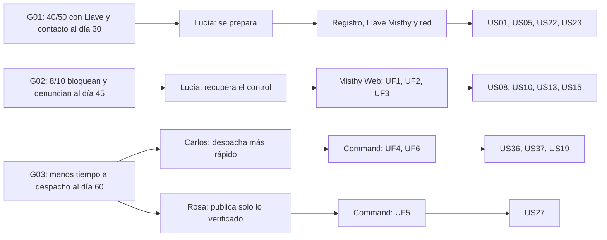

# Capítulo III: Requirements Specification

**Autor:** Christoper Steven Rivas Castillo — [CODERT0PH](https://github.com/CODERT0PH). **Proyecto personal:** MISTHY. **Versión:** 0.2.0. **Fecha:** 10 de octubre de 2026.

[Capítulo I](../capitulo-1/README.md) · [Capítulo II](../capitulo-2/README.md) · [Capítulo IV](../capitulo-4/README.md)

Este capítulo convierte los user goals del capítulo II (UG1–UG10) y los módulos del capítulo I (Misthy App M1–M8, Misthy Web y Misthy Command) en historias verificables. Las seis historias que nacen de los flujos del capítulo IV (UF1–UF6) usan el mismo user goal, la misma persona y los mismos happy y unhappy paths que el diseño en Figma, para que diseño y requisitos no se contradigan. La trazabilidad usa N01–N08 (capítulo II) e H01–H12 (capítulo I).

## Contenido

- [3.1. User Stories](#stories)
- [3.2. Impact Mapping](#impact)
- [3.3. Product Backlog](#backlog)
- [Requisitos no funcionales y trazabilidad](#restricciones)

## 3.1. User Stories

Once épicas, 40 historias de usuario y diez historias técnicas. Los criterios de aceptación siguen Dado–Cuando–Entonces. Las historias marcadas con **UF** son las de los user flows del capítulo IV.

### Épicas

| Epic ID | Título | Descripción | Criterio de aceptación |
|---|---|---|---|
| EP01 | Landing e inclusión | Como visitante deseo entender MISTHY y llegar al producto que me corresponde. | Dado un visitante de cualquier audiencia, cuando explora `misthy.pe`, entonces encuentra su ruta (ciudadano, organización, municipalidad o emergencia). |
| EP02 | Cuenta y Llave Misthy | Como ciudadano deseo preparar mi cuenta y mi Llave Misthy para poder recuperar el control si me roban el celular. | Dada una cuenta verificada, cuando configura su Llave Misthy, entonces puede usar el acceso de emergencia. |
| EP03 | Recuperación del dispositivo (Misthy Web) | Como ciudadana deseo ubicar, bloquear, hacer sonar y proteger mi celular desde cualquier navegador. | Dada una sesión de emergencia, cuando envía una orden remota, entonces ve su estado real hasta la confirmación o el fallo. |
| EP04 | Expediente y denuncia | Como ciudadana deseo reunir evidencia y enviarla a la comisaría para iniciar la denuncia. | Dado un incidente con evidencia, cuando se envía el expediente, entonces recibe código y próximos pasos. |
| EP05 | Pánico y red de confianza (M2) | Como ciudadana deseo pedir ayuda sin desbloquear el celular y que mi red me ubique. | Dada una red aceptada, cuando activo el pánico, entonces contactos y central reciben mi ubicación y se distingue envío de entrega. |
| EP06 | Mapa Vivo y comunidad (M1, M7) | Como vecina deseo conocer zonas de riesgo y aportar reportes verificados. | Dado un reporte verificado, cuando se publica, entonces aparece en el mapa sin datos privados. |
| EP07 | Trayectos y coacción (M3, M5, M8) | Como ciudadana deseo protegerme en trayectos y bajo coacción. | Dado un riesgo en un trayecto, cuando no respondo o uso el PIN falso, entonces se alerta a mi red sin delatarme. |
| EP08 | Anti-robo en el dispositivo (M4) | Como ciudadana deseo que mi celular robado siga siendo localizable y difícil de usar. | Dado un robo, cuando el equipo pierde datos o lo intentan apagar, entonces se conserva la mayor información posible. |
| EP09 | Misthy Command: monitor y despacho | Como operador de serenazgo deseo atender primero lo más grave y despachar rápido. | Dada una alerta, cuando se despacha, entonces queda registrada la unidad, la ruta y su estado. |
| EP10 | Misthy Command: gestión y analítica | Como supervisora deseo analizar patrones y administrar la operación. | Dado un periodo, cuando consulta la analítica, entonces ve patrones por hora, zona y tipo. |
| EP11 | Servicios e integración | Como Developer deseo contratos verificables para integrar app, web y Command. | Dada una operación documentada, cuando se ejecuta, entonces respeta autorización y contratos de éxito y error. |

### Historias de usuario

| Story ID | Título | Descripción | Criterios de aceptación | Epic |
|---|---|---|---|---|
| US01 | Conocer el servicio ciudadano | Como visitante ciudadano, quiero conocer qué hace MISTHY y sus límites para decidir si descargo la app. | **E1.** Dado un visitante sin sesión, cuando abre `misthy.pe`, entonces ve la propuesta «Tu ciudad te cuida», cómo funciona en 3 pasos y el CTA «Descargar app». **E2.** Dado un visitante que lee los planes, cuando compara Free y Pro, entonces ve que pánico, acceso de emergencia, bloqueo y aviso a contactos son gratuitos y que no se promete recuperar el equipo. | EP01 |
| US02 | Solicitar demo para mi organización | Como representante de una municipalidad o junta vecinal, quiero ver Misthy Command y los planes para solicitar una demo. | **E1.** Dado un visitante en «Soluciones» o «Misthy Command», cuando envía el formulario de contacto válido, entonces recibe un código de recepción. **E2.** Dado un error de envío, cuando falla, entonces no se muestra como recibido y se ofrece reintentar. | EP01 |
| US03 | Entrar a emergencia desde el landing | Como persona a quien le acaban de robar el celular, quiero encontrar el acceso de emergencia sin buscar. | **E1.** Dado cualquier ancho de pantalla, cuando se carga el landing, entonces el botón rojo «Emergencia» está visible en el header y lleva a `misthy.app/emergencia`. | EP01 |
| US04 | Usar MISTHY en mi idioma y con teclado | Como usuario, quiero usar es-PE o en-US y operar con teclado y lector de pantalla. | **E1.** Dado un cambio de idioma, cuando se aplica, entonces se conservan los datos y cambian textos y mensajes. **E2.** Dado un usuario de teclado, cuando realiza una tarea esencial, entonces ve el foco y entiende los estados sin depender del color. | EP01 |
| US05 | Crear cuenta y configurar Llave Misthy | Como ciudadana, quiero crear mi cuenta y mi Llave Misthy para poder entrar desde otro equipo si me roban el celular. | **E1.** Dado un correo verificado, cuando completa el registro en la app, entonces se le pide crear una Llave Misthy de 12–16 caracteres distinta de su contraseña. **E2.** Dada la Llave creada, cuando se guarda, entonces solo se almacena un hash y nunca aparece en logs. | EP02 |
| US06 | Iniciar y cerrar sesión | Como usuario registrado, quiero autenticarme y cerrar sesión para controlar el acceso a mis datos. | **E1.** Dadas credenciales válidas, cuando inicia sesión, entonces solo accede a sus recursos. **E2.** Dada una sesión cerrada o vencida, cuando pide un recurso, entonces se deniega. | EP02 |
| US07 | Revocar sesiones y rotar mi Llave | Como titular, quiero cerrar los accesos anteriores y cambiar mi Llave Misthy tras un robo. | **E1.** Dado un titular verificado, cuando revoca sesiones, entonces las siguientes solicitudes con esas sesiones se rechazan. **E2.** Dada una rotación de Llave, cuando termina, entonces la Llave anterior deja de funcionar. | EP02 |
| US08 | Acceder en emergencia con mi Llave Misthy (UF1) | Como ciudadana sin mi celular, quiero entrar con mi correo y mi Llave Misthy desde un navegador prestado. | **E1.** Dado correo y Llave correctos, cuando envía el formulario (pantalla W1), entonces entra al panel de recuperación en el paso 2 de 2. **E2.** Dada una Llave incorrecta, cuando falla, entonces ve los intentos restantes (W1b) sin revelar si la cuenta existe. **E3.** Dados 3 intentos fallidos, cuando se intenta otra vez, entonces el acceso se pausa 15 min y se avisa al correo. | EP03 |
| US09 | Ver el estado de mi dispositivo | Como ciudadana, quiero ver la conexión, batería y última ubicación de mi celular apenas entro al panel. | **E1.** Dado un equipo conectado, cuando abre el panel (W2), entonces ve «Última ubicación recibida a las HH:MM» y la batería. **E2.** Dado un equipo sin conexión, cuando abre el panel, entonces ve «Dispositivo sin conexión. Mostramos la última ubicación disponible.» | EP03 |
| US10 | Bloquear el celular robado (UF1) | Como ciudadana a quien le robaron el celular, quiero bloquearlo desde un navegador prestado para que el ladrón no pueda usarlo. | **E1.** Dado el panel abierto, cuando toca «Bloquear» y confirma (W3), entonces la orden queda «Pendiente de conexión» (W4) y cambia a «Confirmado por el dispositivo» (W4b) cuando el equipo responde; el equipo muestra «Dispositivo reportado — MISTHY». **E2.** Dado un equipo sin conexión, cuando pasan 10 min sin respuesta, entonces ve «No se pudo ejecutar» (W4c) con «Reintentar» y «Avisar a PNP». **E3.** Dado cualquier caso, cuando no hay confirmación del dispositivo, entonces nunca se muestra «bloqueado». | EP03 |
| US11 | Hacer sonar la sirena | Como ciudadana, quiero activar una alarma al 100 % para ubicar el equipo cerca o disuadir al ladrón. | **E1.** Dado un equipo conectado, cuando activa «Sirena», entonces suena aunque esté en silencio y el estado pasa a confirmado. **E2.** Dado un equipo sin conexión, cuando la activa, entonces queda pendiente con el mismo patrón de estados que el bloqueo. | EP03 |
| US12 | Consultar la ubicación y el historial | Como ciudadana, quiero ver dónde está mi celular y su ruta reciente. | **E1.** Dado un equipo que reporta ubicación, cuando abre «Ubicación», entonces ve el punto actualizado cada 5–10 s con hora y precisión. **E2.** Dado un filtro (última hora, hoy, 24 h), cuando lo aplica, entonces la línea de tiempo y los pines numerados del mapa se sincronizan. | EP03 |
| US13 | Proteger la bóveda (UF3) | Como ciudadana, quiero borrar o congelar mis documentos sensibles para que nadie los use si desbloquean el equipo. | **E1.** Dado el panel, cuando toca «Bóveda», entonces se pide un código 2FA (W7). **E2.** Dado un código válido y archivos seleccionados (W8), cuando toca «Borrar seleccionados» y escribe BORRAR (W9), entonces los archivos se eliminan; sin escribir BORRAR el botón queda deshabilitado. **E3.** Dado que elige «Congelar acceso», cuando confirma, entonces la bóveda queda inaccesible y se puede revertir. **E4.** Dados 3 códigos inválidos, cuando intenta otra vez, entonces la bóveda se bloquea 30 min. | EP03 |
| US14 | Avisar a mis contactos desde el panel | Como ciudadana, quiero avisar a mi red de confianza desde la web para que sepan lo que pasó. | **E1.** Dados contactos aceptados, cuando toca «Contactos» y confirma, entonces reciben la alerta con la ubicación autorizada y se muestra «Tus contactos recibieron la alerta.» solo cuando hay confirmación de entrega. **E2.** Dado que no tiene contactos aceptados, cuando intenta avisar, entonces se informa y no se simula el envío. | EP03 |
| US15 | Enviar mi expediente a la PNP (UF2) | Como ciudadana víctima de robo, quiero enviar mi expediente con evidencias a la comisaría para iniciar la denuncia. | **E1.** Dado el panel, cuando toca «Avisar a PNP» (W5), entonces ve el expediente generado (ruta, fotos, audio, datos del equipo), elige la comisaría del sector y acepta la declaración. **E2.** Dado el envío exitoso, cuando termina (W6), entonces recibe un código de expediente y los próximos pasos. **E3.** Sin aceptar la declaración, el botón de envío queda deshabilitado; si el envío falla, ve «Reintentar» y «Descargar PDF». | EP04 |
| US16 | Registrar un incidente privado | Como ciudadana, quiero registrar un robo, amenaza o presunta extorsión para ordenar mi información sin divulgarla. | **E1.** Dada una sesión, cuando registra categoría, relato y fecha (exacta o aproximada), entonces se crea un incidente privado con identificador. **E2.** Dado un reporte sin adjuntos, cuando cumple los datos mínimos, entonces se acepta. **E3.** Dada una presunta extorsión, cuando se registra, entonces nunca se publica en el mapa ni se envía a terceros sin su autorización. | EP04 |
| US17 | Guardar documentos en la Bóveda (M6) | Como ciudadana, quiero guardar mi DNI, fotos y credenciales cifrados para tenerlos protegidos y disponibles. | **E1.** Dado un archivo PDF, JPEG o PNG de hasta 10 MB, cuando lo sube, entonces se cifra con AES-256 y registra nombre, tamaño, fecha y huella de integridad. **E2.** Dado un archivo no admitido, cuando lo intenta subir, entonces se rechaza con el motivo. | EP04 |
| US18 | Seguir el estado de mi expediente | Como ciudadana, quiero saber si la central recibió, revisó o exportó mi expediente. | **E1.** Dado un expediente enviado, cuando lo consulta, entonces ve su estado (Recibido, Revisado, Exportado) con fecha. **E2.** Dado que la central pide información faltante, cuando la consulta, entonces ve qué falta y puede añadirla. | EP04 |
| US19 | Revisar y exportar un expediente PNP (UF6) | Como operador, quiero revisar el expediente que envió una ciudadana y exportarlo para la comisaría. | **E1.** Dado «Expedientes PNP» (C5), cuando abre EXP-2026-00148, entonces ve en el panel lateral (C5b) la ruta, las evidencias y la alerta vinculada. **E2.** Dado un expediente completo, cuando toca «Exportar PDF» o «Marcar revisado», entonces cambia de estado y queda registrado quién lo hizo. **E3.** Dado que falta información (DNI o audio), cuando lo detecta, entonces solicita el dato a la ciudadana y el estado queda «Recibido». | EP04 |
| US20 | Activar el pánico sin desbloquear | Como ciudadana en peligro, quiero activar una alerta con triple pulso del botón de volumen o un gesto del smartwatch. | **E1.** Dada la app configurada, cuando presiona tres veces el botón de volumen, entonces se envía la alerta con GPS a contactos y a la central, sin abrir la app. **E2.** Dada una activación accidental, cuando la cancela en los primeros 5 s con su PIN, entonces no se envía. | EP05 |
| US21 | Grabar audio y compartir ubicación en vivo | Como ciudadana, quiero que el pánico grabe audio cifrado y comparta mi ubicación en vivo. | **E1.** Dada una alerta activa, cuando se inicia, entonces graba hasta 10 min de audio cifrado y lo guarda en la Bóveda. **E2.** Dada una alerta activa, cuando mis contactos la abren, entonces ven mi ubicación con hora; si se interrumpe, ven la antigüedad del último dato. | EP05 |
| US22 | Invitar un contacto de confianza | Como ciudadana, quiero invitar a personas de confianza para que reciban mis alertas. | **E1.** Dado un medio de contacto válido, cuando envía la invitación, entonces queda pendiente hasta que la acepten. **E2.** Dada una invitación rechazada o vencida, cuando se envía una alerta, entonces ese contacto no se incluye. | EP05 |
| US23 | Aceptar o rechazar una invitación | Como contacto invitado, quiero decidir si participo y poder retirarme. | **E1.** Dada una invitación vigente, cuando acepta, entonces se registra su consentimiento con fecha. **E2.** Dado un contacto aceptado, cuando se retira, entonces deja de recibir alertas. | EP05 |
| US24 | Ver el Mapa Vivo y alertas de zona roja | Como ciudadana, quiero saber si entro a una zona roja para tomar precauciones. | **E1.** Dado el mapa abierto, cuando lo consulta, entonces ve el mapa de calor de delitos verificados con fecha y antigüedad. **E2.** Dada la ubicación activa, cuando entra a una zona roja, entonces recibe una alerta de voz o vibración. **E3.** Dada una zona sin reportes, cuando la consulta, entonces se informa «sin reportes», no «zona segura». | EP06 |
| US25 | Encontrar un Punto Misthy | Como ciudadana que se siente seguida, quiero ir al comercio refugio más cercano. | **E1.** Dada mi ubicación, cuando pido «Punto Misthy más cercano», entonces veo la ruta y el horario del comercio aliado. | EP06 |
| US26 | Reportar un incidente en mi barrio | Como vecina, quiero reportar un incidente con evidencia para alertar a la comunidad. | **E1.** Dado un reporte con tipo, zona y evidencia opcional, cuando lo envía, entonces queda «Por verificar» y no se publica hasta ser verificado. **E2.** Dado un reporte de extorsión, cuando lo envía, entonces se trata como incidente privado y nunca se publica. | EP06 |
| US27 | Verificar un reporte comunitario (UF5) | Como supervisora, quiero validar los reportes vecinales con evidencia para publicar solo información confiable en el mapa. | **E1.** Dado «Reportes» (C4) filtrado por evidencia, cuando revisa R-311 y toca «Verificar», entonces se publica en el Mapa Vivo, la vecina recibe puntos y un banner ofrece deshacer (C4b). **E2.** Dada evidencia insuficiente o un duplicado, cuando toca «Descartar», entonces debe indicar motivo y el vecino recibe la notificación. | EP06 |
| US28 | Ganar puntos y badges | Como vecina, quiero recibir puntos y badges cuando mis reportes se verifican. | **E1.** Dado un reporte verificado, cuando se publica, entonces suma puntos a su perfil y puede desbloquear badges como «Explorador Seguro». **E2.** Dado el ranking vecinal, cuando se muestra, entonces usa alias y no datos personales. | EP06 |
| US29 | Viajar en Modo Viaje Seguro | Como pasajera, quiero que mis contactos sean avisados si el taxi se desvía y no respondo. | **E1.** Dado un viaje iniciado con placa escaneada y destino, cuando el vehículo sale de la geocerca, entonces la app pregunta si estoy bien. **E2.** Dado que no respondo en 20 s, cuando vence el tiempo, entonces se alerta a mis contactos con la placa y la ubicación. | EP07 |
| US30 | Usar un PIN de coacción | Como ciudadana obligada a desbloquear mi celular, quiero ingresar un PIN falso que alerte en silencio. | **E1.** Dado el PIN de coacción configurado, cuando lo ingreso, entonces se abre una pantalla señuelo y en segundo plano se activa el Lockdown silencioso y la alerta a contactos y central. **E2.** Dada la pantalla señuelo, cuando alguien la usa, entonces no aparece ningún indicio de la alerta. | EP07 |
| US31 | Usar el Falso Acompañante | Como ciudadana que camina sola, quiero simular una llamada o videollamada para disuadir a quien me sigue. | **E1.** Dado el módulo activo, cuando lo inicio, entonces recibo una llamada simulada con voz IA en menos de 3 s. **E2.** Dada la llamada en curso, cuando presiono el botón de pánico, entonces se activa la alerta sin cortar la simulación. | EP07 |
| US32 | Detectar un «jalón» y tomar fotos stealth | Como ciudadana, quiero que la app detecte un arrebato y fotografíe a quien tiene el equipo. | **E1.** Dado el anti-robo activo, cuando los sensores detectan un arrebato, entonces se envía una alerta y se activa el seguimiento. **E2.** Dado un Lockdown activo, cuando alguien intenta desbloquear, entonces se toma una foto con la cámara frontal y se sube al panel de recuperación. | EP08 |
| US33 | Localizar mi celular sin datos con la Red Mesh | Como ciudadana, quiero que mi celular robado siga siendo ubicable aunque no tenga datos. | **E1.** Dado un equipo sin datos que emite Bluetooth, cuando otro usuario MISTHY pasa cerca, entonces su app retransmite la señal cifrada y el panel muestra la ubicación con hora. **E2.** Dado un equipo apagado, cuando consulto el panel, entonces veo la última ubicación, batería y dirección de movimiento enviadas antes del apagado. | EP08 |
| US34 | Pedir mi Llave para apagar el celular | Como ciudadana, quiero que al intentar apagar mi celular se pida mi Llave Misthy. | **E1.** Dado Android con Device Admin activo, cuando se abre el menú de apagado, entonces se pide la Llave Misthy. **E2.** Dado iOS, cuando se configura, entonces la app explica que esta protección no está disponible. | EP08 |
| US35 | Iniciar sesión en Command con 2FA | Como operador, quiero entrar a Misthy Command con 2FA para proteger la información de la central. | **E1.** Dadas credenciales y código válidos, cuando inicia sesión (C1), entonces entra al monitor según su rol. **E2.** Dados 5 códigos inválidos, cuando intenta otra vez, entonces la cuenta se bloquea temporalmente. | EP09 |
| US36 | Monitorear alertas por severidad | Como operador, quiero ver el mapa distrital y la cola de alertas ordenada por severidad y antigüedad. | **E1.** Dadas alertas activas, cuando abre el monitor (C2), entonces la cola muestra S5 Crítica arriba, con número, etiqueta y color. **E2.** Dados filtros de severidad, estado, sector o tipo, cuando los aplica, entonces el mapa muestra solo lo filtrado y los chips se pueden quitar. | EP09 |
| US37 | Atender una alerta crítica y despachar (UF4) | Como operador de serenazgo, quiero atender la alerta más grave y enviar al sereno más cercano para reducir el tiempo de respuesta. | **E1.** Dada A-2041 (S5), cuando la abre (C3), entonces el detalle aparece junto al mapa con evidencia y serenos cercanos. **E2.** Dado SZ-07 disponible, cuando toca «Despachar» (atajo `D`), entonces la alerta pasa a «despachada» con ruta y tiempo estimado (C3b), y luego a «en sitio». **E3.** Dado que no hay serenos disponibles, cuando intenta despachar, entonces puede escalar a la PNP o asignar una unidad de otro sector. | EP09 |
| US38 | Cerrar una alerta o marcar falsa alarma | Como operador, quiero cerrar una alerta con motivo para mantener la cola limpia y medir falsos positivos. | **E1.** Dada una alerta en sitio, cuando la cierra, entonces registra motivo, responsable y hora. **E2.** Dada una falsa alarma, cuando la marca, entonces se cierra con ese motivo y cuenta en la métrica de falsos positivos. | EP09 |
| US39 | Analizar patrones y riesgo | Como supervisora, quiero ver patrones por hora, zona y tipo de delito y la predicción de riesgo para planificar el patrullaje. | **E1.** Dado un rango de fechas, cuando abre «Analítica» (C6), entonces ve KPIs, horas críticas, zonas y tipos de delito. **E2.** Dada la predicción de riesgo, cuando se muestra, entonces indica el periodo de datos y que es una estimación. | EP10 |
| US40 | Administrar roles, cobertura y Puntos Misthy | Como administrador municipal, quiero gestionar usuarios, sectores y comercios refugio. | **E1.** Dado un administrador, cuando asigna el rol operador, supervisor o admin, entonces el usuario solo ve los módulos de su rol. **E2.** Dado un comercio aliado, cuando lo registra como Punto Misthy, entonces aparece en el Mapa Vivo con horario. | EP10 |

### Historias técnicas

| Story ID | Título | Descripción | Criterios de aceptación | Epic |
|---|---|---|---|---|
| TS01 | API de cuentas y Llave Misthy | Como Developer, quiero verificar la Llave Misthy y emitir sesiones de emergencia restringidas. | **E1.** Dados correo y Llave válidos, cuando se llama `POST /api/v1/emergency/sessions`, entonces responde 200 con una sesión limitada y su vigencia. **E2.** Dadas credenciales inválidas, responde 401 genérico; al superar el umbral responde 429. | EP11 |
| TS02 | API de órdenes remotas | Como Developer, quiero enviar órdenes al dispositivo con estados verificables e idempotencia. | **E1.** Dada una orden con clave de idempotencia, cuando se repite, entonces no se duplica. **E2.** Dado el acuse del dispositivo, cuando llega, entonces el estado pasa a `confirmed`; sin acuse en 10 min pasa a `failed`. | EP11 |
| TS03 | Canal en tiempo real | Como Developer, quiero publicar ubicaciones, alertas y estados en tiempo real (Firebase o Supabase). | **E1.** Dado un cambio de estado, cuando se publica, entonces el panel y Command lo reciben en menos de 2 s en condiciones normales. **E2.** Dada una desconexión, cuando se recupera, entonces el cliente sincroniza el último estado. | EP11 |
| TS04 | API de expedientes y archivos | Como Developer, quiero generar expedientes PDF y gestionar archivos con autorización. | **E1.** Dado un archivo de más de 10 MB, responde 413; un formato no admitido, 415. **E2.** Dado permiso insuficiente, cuando se pide un expediente, entonces responde 403 sin generarlo. | EP11 |
| TS05 | API de alertas y despacho | Como Developer, quiero asignar unidades con control de concurrencia. | **E1.** Dada una versión vigente, cuando se despacha, entonces responde 201 y registra actor y hora. **E2.** Dada una versión desactualizada, cuando dos operadores despachan a la vez, entonces el segundo recibe 409. | EP11 |
| TS06 | Autorización por rol y organización | Como Developer, quiero aplicar permisos por propietario, rol y municipalidad. | **E1.** Dado un operador de la municipalidad A, cuando consulta una alerta de B, entonces no obtiene datos ni confirma su existencia. | EP11 |
| TS07 | Integración cartográfica | Como Developer, quiero mapas y geocodificación de un proveedor externo sin enviar datos privados. | **E1.** Dado un timeout del proveedor, cuando falla, entonces el registro se guarda sin mapa y se informa. **E2.** Dado un incidente privado, cuando se geocodifica, entonces no se envía relato ni identidad. | EP11 |
| TS08 | OpenAPI y errores estables | Como Developer, quiero un contrato OpenAPI y errores con código estable e ID de correlación. | **E1.** Dado el contrato publicado, cuando se consulta, entonces describe autenticación, parámetros y respuestas de cada operación. **E2.** Dado un error inesperado, cuando responde la API, entonces no expone trazas ni secretos. | EP11 |
| TS09 | Cifrado de la Bóveda | Como Developer, quiero cifrar la bóveda con AES-256 y gestionar llaves por usuario. | **E1.** Dado un archivo subido, cuando se almacena, entonces queda cifrado en reposo con una llave por usuario. **E2.** Dado un borrado confirmado, cuando se ejecuta, entonces la llave y el archivo se eliminan. | EP11 |
| TS10 | Prueba técnica de Red Mesh BLE | Como Developer, quiero validar la retransmisión Bluetooth cifrada en Android antes de comprometer la función. | **E1.** Dados dos equipos de prueba, cuando uno sin datos emite y el otro retransmite, entonces el servidor recibe la ubicación cifrada y el resultado queda documentado. | EP11 |

## 3.2. Impact Mapping

Tres metas SMART para el piloto de 60 días en VES. Los actores son las personas del capítulo II.

| Business goal | Actor | Impacto esperado | Deliverable | User stories |
|---|---|---|---|---|
| G01: 40 de 50 ciudadanos invitados configuran Llave Misthy y un contacto aceptado antes del día 30. | Lucía (ciudadana) | Se prepara antes de necesitarlo. | Registro, Llave Misthy, red de confianza, landing. | US01, US05, US22, US23 |
| G02: antes del día 45, 8 de 10 participantes bloquean su celular desde un navegador prestado en ≤3 min y envían su expediente a la PNP sin ayuda. | Lucía (ciudadana) | Recupera el control y denuncia con evidencia. | Acceso de emergencia, bloqueo, bóveda y expediente (UF1–UF3). | US08, US10, US13, US15 |
| G03: antes del día 60, el tiempo mediano entre una alerta S5 y el despacho baja frente a la semana 5, y la municipalidad acepta continuar con Misthy Command. | Carlos (operador) y Rosa (supervisora) | Atienden primero lo grave y publican solo información confiable. | Monitor, despacho, reportes y expedientes (UF4–UF6). | US36, US37, US27, US19 |

## 3.3. Product Backlog

Ordenado por valor para el MVP del capítulo I: primero la recuperación desde Misthy Web y el pánico, después Command y al final los módulos de fase 2. Story Points en escala 1, 2, 3, 5, 8 (estimaciones iniciales del autor).

| Orden | ID | Título | Story Points | Fase |
|---|---|---|---|---|
| 1 | US05 | Crear cuenta y configurar Llave Misthy | 5 | MVP |
| 2 | US08 | Acceder en emergencia con mi Llave Misthy (UF1) | 5 | MVP |
| 3 | US09 | Ver el estado de mi dispositivo | 3 | MVP |
| 4 | US10 | Bloquear el celular robado (UF1) | 8 | MVP |
| 5 | US11 | Hacer sonar la sirena | 3 | MVP |
| 6 | US12 | Consultar la ubicación y el historial | 5 | MVP |
| 7 | US13 | Proteger la bóveda (UF3) | 8 | MVP |
| 8 | US15 | Enviar mi expediente a la PNP (UF2) | 8 | MVP |
| 9 | US20 | Activar el pánico sin desbloquear | 8 | MVP |
| 10 | US21 | Grabar audio y compartir ubicación en vivo | 5 | MVP |
| 11 | US22 | Invitar un contacto de confianza | 3 | MVP |
| 12 | US23 | Aceptar o rechazar una invitación | 2 | MVP |
| 13 | US14 | Avisar a mis contactos desde el panel | 3 | MVP |
| 14 | US17 | Guardar documentos en la Bóveda (M6) | 5 | MVP |
| 15 | US24 | Ver el Mapa Vivo y alertas de zona roja | 8 | MVP |
| 16 | US32 | Detectar un «jalón» y tomar fotos stealth | 8 | MVP |
| 17 | US06 | Iniciar y cerrar sesión | 3 | MVP |
| 18 | US07 | Revocar sesiones y rotar mi Llave | 3 | MVP |
| 19 | US01 | Conocer el servicio ciudadano | 3 | MVP |
| 20 | US03 | Entrar a emergencia desde el landing | 1 | MVP |
| 21 | US04 | Usar MISTHY en mi idioma y con teclado | 5 | MVP |
| 22 | US35 | Iniciar sesión en Command con 2FA | 3 | Piloto |
| 23 | US36 | Monitorear alertas por severidad | 8 | Piloto |
| 24 | US37 | Atender una alerta crítica y despachar (UF4) | 8 | Piloto |
| 25 | US38 | Cerrar una alerta o marcar falsa alarma | 2 | Piloto |
| 26 | US19 | Revisar y exportar un expediente PNP (UF6) | 5 | Piloto |
| 27 | US18 | Seguir el estado de mi expediente | 3 | Piloto |
| 28 | US26 | Reportar un incidente en mi barrio | 3 | Piloto |
| 29 | US27 | Verificar un reporte comunitario (UF5) | 5 | Piloto |
| 30 | US28 | Ganar puntos y badges | 3 | Piloto |
| 31 | US16 | Registrar un incidente privado | 5 | Piloto |
| 32 | US02 | Solicitar demo para mi organización | 2 | Piloto |
| 33 | US25 | Encontrar un Punto Misthy | 3 | Piloto |
| 34 | US40 | Administrar roles, cobertura y Puntos Misthy | 5 | Piloto |
| 35 | US39 | Analizar patrones y riesgo | 8 | Fase 2 |
| 36 | US29 | Viajar en Modo Viaje Seguro | 8 | Fase 2 |
| 37 | US30 | Usar un PIN de coacción | 8 | Fase 2 |
| 38 | US31 | Usar el Falso Acompañante | 8 | Fase 2 |
| 39 | US33 | Localizar mi celular sin datos con la Red Mesh | 8 | Fase 2 |
| 40 | US34 | Pedir mi Llave para apagar el celular | 5 | Fase 2 |
| 41 | TS01 | API de cuentas y Llave Misthy | 5 | MVP |
| 42 | TS02 | API de órdenes remotas | 8 | MVP |
| 43 | TS03 | Canal en tiempo real | 5 | MVP |
| 44 | TS04 | API de expedientes y archivos | 5 | MVP |
| 45 | TS06 | Autorización por rol y organización | 5 | MVP |
| 46 | TS08 | OpenAPI y errores estables | 3 | MVP |
| 47 | TS09 | Cifrado de la Bóveda | 5 | MVP |
| 48 | TS07 | Integración cartográfica | 3 | MVP |
| 49 | TS05 | API de alertas y despacho | 5 | Piloto |
| 50 | TS10 | Prueba técnica de Red Mesh BLE | 8 | Fase 2 |

**Total: 254 Story Points** (MVP 141, piloto 60, fase 2 53). Todas las historias están en estado **Propuesta**.

| Fase | Resultado observable | Dependencia |
|---|---|---|
| MVP (semanas 1–4) | La ciudadana se prepara en la app, pide ayuda con el pánico y, si le roban el celular, lo bloquea, protege la bóveda y envía el expediente desde Misthy Web. | TS01–TS04, TS06–TS09. |
| Piloto (semanas 5–8) | El serenazgo atiende y despacha desde Command, revisa expedientes y verifica reportes comunitarios. | TS05, acuerdo con la municipalidad y la comisaría del sector. |
| Fase 2 | Viaje Seguro, PIN de coacción, Falso Acompañante, Red Mesh, kiosk de apagado y analítica predictiva. | TS10 y resultados de H10–H11. |

El backlog vive en este Markdown y en la rama `feature-capitulo3`. Si se adopta un tablero (Trello, Jira o GitHub Projects), se mantendrán los mismos identificadores.

## Requisitos no funcionales y trazabilidad

### Requisitos no funcionales

| ID | Requisito | Verificación |
|---|---|---|
| RNF01 | Cada usuario, rol y municipalidad solo accede a lo autorizado. | Matriz de permisos con casos permitidos y denegados. |
| RNF02 | La Llave Misthy, los archivos de la bóveda y los audios nunca aparecen en logs, enlaces públicos ni en el mapa. | Revisión de respuestas, registros y recursos publicados. |
| RNF03 | Las acciones relevantes registran actor, hora, origen y motivo. | Reconstrucción de un caso de prueba completo. |
| RNF04 | Ninguna orden remota, alerta o envío se muestra como ejecutado sin confirmación. | Casos de éxito, timeout, rechazo y sin conexión. |
| RNF05 | WCAG 2.1 AA: contraste 4.5:1, foco visible de 3 px, objetivos ≥ 44 px, estados con texto e ícono (capítulo IV, 4.1.2). | Revisión automática y manual con lector de pantalla. |
| RNF06 | Interfaz es-PE con alternativa en-US; fechas con zona horaria. | Pruebas de idioma y fechas. |
| RNF07 | p95 ≤ 2 s en operaciones simples con 20 usuarios concurrentes; tiempo real ≤ 2 s. | Prueba de carga documentada. |
| RNF08 | Los reintentos no duplican alertas ni órdenes; RPO 24 h y RTO 8 h. | Pruebas de idempotencia y restauración. |
| RNF09 | Los reportes de extorsión nunca se publican y la severidad nunca depende del plan de pago. | Casos negativos de publicación y de priorización. |
| RNF10 | La Bóveda usa AES-256 en reposo y TLS en tránsito. | Revisión de configuración y prueba de borrado. |

### Matriz de trazabilidad

| Historia | User goal / flujo | Pantallas del capítulo IV | Necesidad | Hipótesis | Épica |
|---|---|---|---|---|---|
| US01–US03 | — | Landing 4.3 | N03, N05 | H01 | EP01 |
| US04 | — | Todas | N05 | H02 | EP01 |
| US05–US07 | UG1 | — | N03 | H05 | EP02 |
| US08 | UG1 / UF1 | W1, W1b | N03 | H05 | EP03 |
| US09 | UG1 / UF1 | W2 | N04 | H05 | EP03 |
| US10 | UG1 / UF1 | W3, W4, W4b, W4c | N03, N04 | H05 | EP03 |
| US11, US12 | UG1 | W2 | N03 | H05 | EP03 |
| US13 | UG3 / UF3 | W7, W8, W9 | N02 | H09 | EP03 |
| US14 | UG7 | W2 | N04 | H02 | EP03 |
| US15 | UG2 / UF2 | W5, W6 | N06 | H06 | EP04 |
| US16, US17 | UG2 | — | N02, N06 | H03 | EP04 |
| US18 | UG2 | W6 | N01 | H04 | EP04 |
| US19 | UG6 / UF6 | C5, C5b | N06, N01 | H04, H06 | EP04 |
| US20, US21 | UG7 | — | N04, N07 | H02 | EP05 |
| US22, US23 | UG7 | — | N02 | H01 | EP05 |
| US24, US25 | UG8 | — | N08 | H07 | EP06 |
| US26 | UG5 | — | N08 | H12 | EP06 |
| US27 | UG5 / UF5 | C4, C4b | N08 | H07, H12 | EP06 |
| US28 | UG5 | — | N08 | H12 | EP06 |
| US29 | UG9 | — | N08 | H10 | EP07 |
| US30 | UG10 | — | N02 | H10 | EP07 |
| US31 | — | — | N08 | H10 | EP07 |
| US32–US34 | UG1 | — | N03 | H11 | EP08 |
| US35 | UG4 / UF4 | C1 | N07 | H08 | EP09 |
| US36 | UG4 / UF4 | C2 | N07 | H08 | EP09 |
| US37 | UG4 / UF4 | C3, C3b | N07 | H08 | EP09 |
| US38 | UG4 | C3 | N01 | H08 | EP09 |
| US39 | — | C6 | N07 | H08 | EP10 |
| US40 | — | — | N08 | H07 | EP10 |
| TS01–TS10 | — | — | N02, N03, N04 | H05, H08, H11 | EP11 |
