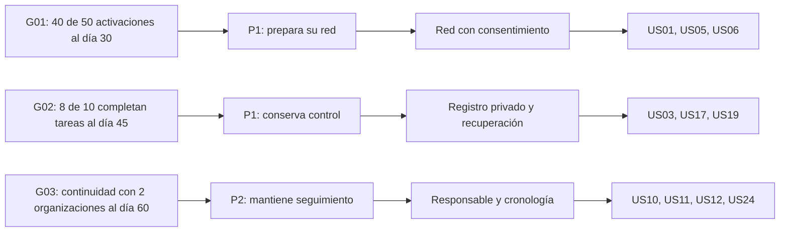

# Capítulo III: Requirements Specification

**Autor:** Christoper Steven Rivas Castillo — **CODERT0PH**. **Proyecto personal:** MISTHY. **Versión:** 0.1.0. **Fecha:** 9 de octubre de 2026.

[Capítulo I](https://github.com/CODERT0PH/MISTHY-/blob/feature-capitulo1/docs/capitulo-1/README.md) · [Capítulo II](https://github.com/CODERT0PH/MISTHY-/blob/feature-capitulo2/docs/capitulo-2/README.md)

Los requisitos convierten la visión del fundador y la investigación documental en una propuesta verificable. No se afirma que estén implementados ni validados por entrevistas. La trazabilidad usa N01–N06 del capítulo II e H01–H07 del capítulo I. Los contratos técnicos son propuestas para Node.js, no endpoints desplegados. Figma y capítulo IV quedan fuera de esta rama.

## Contenido

- [3.1. User Stories](#stories)
- [3.2. Impact Mapping](#impact)
- [3.3. Product Backlog](#backlog)
- [Restricciones, trazabilidad y preparación del diseño](#restricciones)

## 3.1. User Stories

Se definen siete épicas, 24 historias de usuario y ocho historias técnicas. Los criterios están en presente y describen comportamientos comprobables sin imponer una composición visual. Cada escenario sigue Dado–Cuando–Entonces (Given–When–Then). Las épicas agrupan resultados; no se estiman además de sus historias para evitar doble conteo.

| Epic / Story ID | Título | Descripción | Criterios de aceptación | Relacionado con (Epic ID) |
|---|---|---|---|---|
| EP01 | Descubrimiento e inclusión | Como visitante deseo comprender y acceder al servicio para evaluar su utilidad. | Dado un visitante de cualquiera de los segmentos, cuando explora la oferta, entonces comprende límites y accede al flujo correspondiente. | — |
| EP02 | Registro privado y material de respaldo | Como ciudadano deseo organizar un incidente para conservar información controlada. | Dado un incidente propio, cuando se registra y exporta información autorizada, entonces conserva procedencia y privacidad. | — |
| EP03 | Red de confianza y apoyo | Como ciudadano deseo preparar y avisar a mi red para solicitar apoyo. | Dada una red aceptada, cuando se solicita apoyo, entonces se diferencia envío, recepción y actuación. | — |
| EP04 | Coordinación y seguimiento | Como usuario autorizado deseo conocer responsables y actuaciones para mantener continuidad. | Dada una solicitud compartida, cuando cambia su seguimiento, entonces conserva actor, fecha y motivo. | — |
| EP05 | Información comunitaria responsable | Como ciudadano deseo consultar avisos moderados para informarme del entorno. | Dado un aviso publicable, cuando se consulta, entonces no expone información privada ni garantiza seguridad. | — |
| EP06 | Acceso y control de información | Como titular deseo gestionar acceso y permisos para conservar control de mis datos. | Dado un permiso válido, cuando se accede a un recurso, entonces solo se entrega el alcance autorizado. | — |
| EP07 | Servicios e integración | Como Developer deseo contratos verificables para integrar las experiencias de MISTHY. | Dada una operación documentada, cuando se ejecuta, entonces respeta autorización y contratos de éxito y error. | — |
| US01 | Conocer el servicio ciudadano | Como visitante ciudadano, deseo conocer el alcance, límites y acceso al servicio para decidir si responde a mi necesidad. | **Escenario 1.** Dado un visitante sin sesión, cuando consulta el servicio, entonces obtiene su propósito, funciones esenciales y límites sin registrarse. **Escenario 2.** Dado un visitante que decide continuar, cuando solicita acceso ciudadano, entonces se dirige a la experiencia web correspondiente sin una promesa de atención policial garantizada. | EP01 |
| US02 | Evaluar coordinación organizacional | Como visitante de una organización, deseo conocer condiciones y solicitar información de un piloto para evaluar su utilidad para mi organización. | **Escenario 1.** Dado un visitante organizacional, cuando consulta la propuesta, entonces conoce cobertura prevista, responsabilidades y carácter exploratorio de los precios. **Escenario 2.** Dada una solicitud válida de contacto consentido, cuando se registra, entonces obtiene una referencia de recepción; si falla, no se confirma como recibida. | EP01 |
| US03 | Registrar un incidente privado | Como ciudadano, deseo registrar un robo, amenaza o presunta extorsión para organizar mi información sin divulgarla. | **Escenario 1.** Dado un ciudadano autenticado, cuando aporta categoría, relato y fecha conocida o marcada como aproximada, entonces se crea un incidente privado con identificador y fecha de registro. **Escenario 2.** Dado un reporte sin adjuntos o sin ubicación exacta, cuando cumple los datos mínimos, entonces se acepta; la falta de pruebas no impide solicitar apoyo. **Escenario 3.** Dado un incidente de presunta extorsión, cuando se registra, entonces no se publica en el mapa ni se envía automáticamente a terceros. | EP02 |
| US04 | Solicitar apoyo a la red | Como ciudadano, deseo avisar a mis contactos aceptados para pedir apoyo y conocer el resultado del envío. | **Escenario 1.** Dado un incidente propio y contactos aceptados, cuando se confirma una solicitud de apoyo, entonces se generan avisos con la información autorizada y estado inicial pendiente. **Escenario 2.** Dado un proveedor que rechaza un envío, cuando informa el fallo, entonces el aviso queda fallido; no se registra recepción ni atención. **Escenario 3.** Dado que no hay contactos aceptados, cuando se solicita apoyo, entonces se informa la ausencia de destinatarios sin simular un envío. | EP03 |
| US05 | Invitar un contacto de confianza | Como ciudadano, deseo invitar a una persona de confianza para preparar mi red de apoyo. | **Escenario 1.** Dado un ciudadano con un medio de contacto válido, cuando envía una invitación, entonces queda pendiente hasta que el destinatario acepta. **Escenario 2.** Dada una invitación rechazada o vencida, cuando se prepara una alerta, entonces ese destinatario no se incluye. | EP03 |
| US06 | Aceptar o rechazar una invitación | Como contacto invitado, deseo decidir si participo y retirar mi aceptación para controlar mi disponibilidad y mis datos. | **Escenario 1.** Dada una invitación vigente, cuando el destinatario acredita acceso al medio invitado y acepta, entonces queda registrado el consentimiento y su fecha. **Escenario 2.** Dado un contacto aceptado, cuando retira su consentimiento, entonces deja de recibir nuevos avisos y pierde el acceso compartido asociado. | EP03 |
| US07 | Consultar y corregir la cronología | Como ciudadano, deseo ordenar hechos y actuaciones de mi incidente para comprender qué ocurrió y qué se ha hecho. | **Escenario 1.** Dado un incidente propio, cuando se consulta su cronología, entonces cada entrada identifica autor, fecha del hecho, fecha de registro y procedencia. **Escenario 2.** Dada una entrada incorrecta, cuando el autor la rectifica, entonces la corrección conserva referencia al original y motivo; no altera silenciosamente el historial. | EP02 |
| US08 | Conservar material de respaldo | Como ciudadano, deseo adjuntar archivos privados de forma voluntaria para mantener información relacionada con el incidente. | **Escenario 1.** Dado un incidente propio, cuando se aporta un PDF, JPEG o PNG de hasta 10 MB, entonces el archivo se mantiene privado y registra nombre, tamaño, fecha y huella de integridad. **Escenario 2.** Dado un archivo no admitido o identificado como riesgoso en la validación, cuando se intenta incorporar, entonces se rechaza o queda aislado sin estar disponible para compartir. **Escenario 3.** Dada una huella coincidente, cuando se consulta el material, entonces se informa integridad desde el registro y no se certifica autenticidad del contenido. | EP02 |
| US09 | Exportar una copia del caso | Como ciudadano, deseo seleccionar información y exportar un resumen para compartir una copia ordenada bajo mi responsabilidad. | **Escenario 1.** Dado un ciudadano con acceso al incidente, cuando selecciona entradas y solicita exportación, entonces obtiene un PDF con fechas, procedencia y referencia de archivos seleccionados. **Escenario 2.** Dado material no autorizado para el solicitante, cuando se genera la copia, entonces se excluye; el documento identifica su origen en MISTHY y no se presenta como denuncia o certificación judicial. | EP02 |
| US10 | Consultar seguimiento y pendientes | Como ciudadano, deseo conocer responsable, última actuación y próximo paso para reducir incertidumbre sobre mi solicitud. | **Escenario 1.** Dada una solicitud con seguimiento, cuando su titular la consulta, entonces conoce responsable si existe, última actualización y acciones pendientes. **Escenario 2.** Dada una solicitud sin actuación, cuando se consulta, entonces se muestra pendiente y antigüedad sin afirmar que una autoridad la atiende. | EP04 |
| US11 | Asignar responsable local | Como coordinador autorizado, deseo asignar o transferir seguimiento para evitar solicitudes sin continuidad. | **Escenario 1.** Dada una solicitud compartida con la organización, cuando un coordinador asigna un responsable vigente de su ámbito, entonces se registra quién asigna y cuándo. **Escenario 2.** Dada una transferencia, cuando se confirma, entonces se conserva el responsable anterior; una persona ajena a la organización no puede ser asignada. | EP04 |
| US12 | Registrar actuaciones y recordatorios | Como coordinador autorizado, deseo registrar acciones y próximos pasos para mantener un seguimiento verificable. | **Escenario 1.** Dado un caso autorizado, cuando se registra una actuación, entonces incluye responsable, fecha, descripción y próxima revisión opcional. **Escenario 2.** Dada una revisión vencida, cuando se evalúan pendientes, entonces se señala el vencimiento sin convertirlo en confirmación de incumplimiento legal ni emitir un despacho automático. | EP04 |
| US13 | Añadir referencias externas | Como ciudadano, deseo registrar una constancia o referencia de gestión externa para relacionar mis gestiones sin confundirlas con el registro interno. | **Escenario 1.** Dado un incidente propio, cuando se añade una referencia externa, entonces se registra entidad indicada, fecha, identificador disponible y origen declarado por el usuario. **Escenario 2.** Dada una referencia sin verificación institucional, cuando se consulta, entonces aparece como aportada por el usuario y no como sincronización oficial. | EP04 |
| US14 | Priorizar con criterios explícitos | Como coordinador autorizado, deseo clasificar urgencia y registrar el motivo para organizar atención sin favorecer a quien paga más. | **Escenario 1.** Dada una solicitud autorizada, cuando se asigna prioridad operativa alta, media o baja, entonces se registra motivo y responsable según una política acordada. **Escenario 2.** Dadas dos solicitudes equivalentes, cuando difiere solo el plan de pago, entonces la prioridad no cambia por ese dato; toda modificación queda trazada. | EP04 |
| US15 | Moderar avisos comunitarios | Como moderador autorizado, deseo revisar avisos antes de publicación para reducir exposición e información engañosa. | **Escenario 1.** Dado un aviso propuesto, cuando el moderador lo aprueba, entonces publica solo categoría general, fecha y zona aproximada sin identidades ni adjuntos privados. **Escenario 2.** Dado un reporte de extorsión o contenido identificable, cuando se revisa, entonces no se publica como aviso comunitario y se registra el motivo. | EP05 |
| US16 | Consultar avisos del entorno | Como ciudadano, deseo consultar avisos moderados con fecha y zona para informarme sin confundir reportes con seguridad garantizada. | **Escenario 1.** Dada una zona consultada, cuando existen avisos aprobados y vigentes, entonces se muestran categoría, fecha y carácter informativo sin datos privados. **Escenario 2.** Dada una zona sin avisos, cuando se consulta, entonces se informa ausencia de registros y no ausencia de riesgo. | EP05 |
| US17 | Recuperar acceso con Llave Misthy | Como titular de cuenta, deseo acceder desde otro equipo con una llave de recuperación para recuperar control si pierdo mi dispositivo habitual. | **Escenario 1.** Dada una cuenta con llave generada y vigente, cuando se verifican correo y llave, entonces se emite una sesión de emergencia limitada a recuperar control y consultar metadatos mínimos. **Escenario 2.** Dada una llave inválida, cuando se intenta acceder, entonces se responde sin revelar existencia de cuenta y se aplica limitación de intentos. **Escenario 3.** Dada una sesión de emergencia, cuando se solicitan archivos, exportaciones o eliminación, entonces se exige verificación adicional independiente; la llave por sí sola no autoriza esas acciones. | EP06 |
| US18 | Revocar sesiones de MISTHY | Como titular de cuenta, deseo cerrar accesos anteriores y rotar mi llave para reducir exposición tras una pérdida. | **Escenario 1.** Dado un titular verificado, cuando revoca una sesión, entonces sus siguientes solicitudes dejan de estar autorizadas. **Escenario 2.** Dada una rotación de llave autorizada, cuando finaliza, entonces la llave anterior deja de servir; se informa que esto no bloquea ni borra el teléfono. | EP06 |
| US19 | Gestionar permisos de acceso | Como ciudadano, deseo autorizar y revocar acceso limitado a mi incidente para decidir quién conoce mis datos. | **Escenario 1.** Dado un incidente propio, cuando se concede permiso a un destinatario identificado, entonces se delimita el alcance y vigencia. **Escenario 2.** Dado un permiso revocado o vencido, cuando el destinatario intenta una nueva consulta, entonces se deniega; se informa que una copia ya descargada no puede retirarse remotamente. | EP06 |
| US20 | Crear y preparar una cuenta | Como ciudadano, deseo crear mi cuenta y configurar recuperación para preparar el uso del servicio. | **Escenario 1.** Dado un correo verificado y condiciones aceptadas, cuando se completa el registro, entonces se crea una cuenta sin publicar datos personales. **Escenario 2.** Dada la preparación de recuperación, cuando se genera una llave, entonces se entrega al titular y se almacena solo una representación de verificación; no se incluye en registros de actividad. | EP06 |
| US21 | Acceder y cerrar sesión | Como usuario registrado, deseo autenticarme y cerrar mi sesión para usar mis recursos con control de acceso. | **Escenario 1.** Dadas credenciales válidas, cuando el usuario se autentica, entonces obtiene acceso solo a sus recursos y permisos. **Escenario 2.** Dada una sesión cerrada o vencida, cuando se solicita un recurso protegido, entonces se deniega y no se reutiliza una sesión de otro usuario. | EP06 |
| US22 | Usar una experiencia comprensible y accesible | Como usuario, deseo consultar el servicio en español o inglés y operar con teclado para utilizarlo según mis necesidades. | **Escenario 1.** Dado un usuario que elige es-PE o en-US, cuando cambia el idioma, entonces se conservan sus datos y se actualizan textos y mensajes del flujo. **Escenario 2.** Dado un usuario que navega con teclado y lector de pantalla, cuando realiza una tarea esencial, entonces identifica controles, foco y mensajes sin depender exclusivamente del color. | EP01 |
| US23 | Compartir ubicación con consentimiento | Como ciudadano, deseo aportar ubicación a una solicitud autorizada para dar contexto sin perder control sobre el seguimiento. | **Escenario 1.** Dado permiso expreso y una posición disponible, cuando se comparte, entonces se incluyen fecha de captura y precisión con acceso restringido. **Escenario 2.** Dado permiso denegado o conexión interrumpida, cuando se consulta la solicitud, entonces se informa la ausencia o antigüedad del dato y no se simula rastreo en vivo. | EP03 |
| US24 | Cerrar y reabrir seguimiento | Como ciudadano o coordinador autorizado, deseo registrar cierre o reapertura con motivo para mantener continuidad sin confundir cierre interno con justicia obtenida. | **Escenario 1.** Dado un seguimiento activo y autorización, cuando se cierra, entonces se conserva fecha, responsable y motivo con la etiqueta cierre interno. **Escenario 2.** Dada nueva información y autorización, cuando se reabre, entonces se preserva el historial y vuelve al seguimiento sin declarar una resolución judicial. | EP04 |
| TS01 | API de incidentes y cronología | Como Developer, deseo crear y consultar incidentes mediante contratos consistentes para integrar las experiencias web. | **Escenario 1.** Dada autenticación válida y carga admisible, cuando se envía POST /api/v1/incidents, entonces responde 201 con identificador y recurso privado. **Escenario 2.** Dada carga inválida, cuando se envía la solicitud, entonces responde 400 con errores de validación; un GET sin permiso responde 404 sin filtrar existencia del recurso. | EP07 |
| TS02 | API de archivos y exportación | Como Developer, deseo incorporar material y generar exportaciones autorizadas para conservar procedencia y privacidad. | **Escenario 1.** Dado un archivo admitido y autorización, cuando se carga en un incidente, entonces responde 202 con estado pendiente de validación; solo queda disponible tras validación satisfactoria. **Escenario 2.** Dado un archivo de más de 10 MB, cuando se envía, entonces responde 413; un formato no admitido responde 415. **Escenario 3.** Dado permiso insuficiente, cuando se solicita una exportación, entonces responde 403 sin generar una copia. | EP07 |
| TS03 | API de alertas y estados de entrega | Como Developer, deseo procesar alertas de forma idempotente para evitar avisos duplicados y estados falsos. | **Escenario 1.** Dada una solicitud válida con clave de idempotencia, cuando se repite POST de alerta con la misma carga y clave, entonces devuelve el mismo resultado sin duplicar avisos. **Escenario 2.** Dada la misma clave con otra carga, cuando se reintenta, entonces responde 409. **Escenario 3.** Dado un proveedor que confirma recepción técnica, cuando se procesa el evento, entonces no se registra lectura humana sin evidencia adicional. | EP07 |
| TS04 | API de seguimiento y concurrencia | Como Developer, deseo actualizar actuaciones con control de versión para evitar pérdida de cambios y conservar auditoría. | **Escenario 1.** Dada una versión vigente y permiso, cuando se añade una actuación, entonces responde 201 y registra actor, momento y nueva versión. **Escenario 2.** Dada una versión desactualizada, cuando se cambia responsable o estado, entonces responde 409 sin sobrescribir la actualización previa. | EP07 |
| TS05 | API de recuperación y revocación | Como Developer, deseo verificar llaves y revocar sesiones para proteger el acceso de emergencia. | **Escenario 1.** Dada una llave válida y cuenta habilitada, cuando se solicita recuperación, entonces responde 200 con sesión restringida, vigencia y alcance explícitos. **Escenario 2.** Dadas credenciales inválidas, cuando se procesa el intento, entonces responde 401 genérico; al exceder el umbral definido responde 429. **Escenario 3.** Dada una sesión revocada, cuando se reutiliza, entonces responde 401 y no ejecuta ninguna acción. | EP07 |
| TS06 | Autorización por recurso y organización | Como Developer, deseo aplicar permisos de propietario y ámbito para impedir acceso cruzado a información sensible. | **Escenario 1.** Dado un coordinador de organización A, cuando intenta consultar un incidente solo autorizado a B, entonces no obtiene datos ni metadatos de existencia. **Escenario 2.** Dado un permiso caducado, cuando llega una nueva solicitud, entonces se deniega aunque el cliente conserve un enlace anterior. | EP07 |
| TS07 | Integración cartográfica externa | Como Developer, deseo resolver zonas con un proveedor cartográfico externo para dar contexto geográfico controlando errores y exposición. | **Escenario 1.** Dada una zona pública y proveedor configurado, cuando se solicita geocodificación, entonces se obtiene ubicación normalizada con atribución del proveedor. **Escenario 2.** Dado timeout o cuota agotada, cuando falla la consulta, entonces se mantiene el registro sin mapa y se informa indisponibilidad. **Escenario 3.** Dado un incidente privado, cuando se invoca al proveedor, entonces no se envían relato, identidad ni adjuntos; el proveedor definitivo se selecciona antes de implementar. | EP07 |
| TS08 | Contrato documentado y errores estables | Como Developer, deseo consultar documentación OpenAPI y respuestas consistentes para integrar y verificar la API. | **Escenario 1.** Dado un contrato publicado, cuando se consulta, entonces describe autenticación, parámetros, respuestas de éxito y errores de cada operación del MVP. **Escenario 2.** Dado un error inesperado, cuando responde la API, entonces devuelve un código estable e identificador de correlación sin secretos ni trazas internas. | EP07 |

## 3.2. Impact Mapping

Se proponen tres metas SMART para un piloto limitado. Día 0 comienza cuando existan participantes consentidos, capacidad operativa y aprobación del fundador. Los umbrales son objetivos experimentales, no logros alcanzados. P1 y P2 son las proto-personas del capítulo II y necesitan validación.

| Business goal | Actor / persona | Impact: cambio de comportamiento esperado | Deliverable | Historias relacionadas, expresadas como intención |
|---|---|---|---|---|
| G01: conseguir que 40 de 50 ciudadanos invitados configuren un contacto aceptado antes del día 30. | P1 — Ciudadano; contacto como actor de apoyo. | Prepara su apoyo antes de necesitarlo y comprende límites. | Información del servicio y red aceptada. | US01: Como visitante ciudadano deseo conocer alcance y límites para decidir si responde a mi necesidad. US05: Como ciudadano deseo invitar a una persona de confianza para preparar mi red. US06: Como contacto deseo decidir si participo para controlar mis datos. |
| G02: antes del día 45, al menos 8 de 10 participantes completan cada tarea controlada de registro privado y recuperación, con límites de 5 y 3 minutos respectivamente. | P1 — Ciudadano. | Organiza información y recupera control sin divulgar datos. | Registro privado, permisos y recuperación. | US03: Como ciudadano deseo registrar un incidente para organizar información sin divulgarla. US17: Como titular deseo recuperar acceso desde otro equipo para recuperar control. US19: Como ciudadano deseo gestionar permisos para decidir quién conoce mis datos. |
| G03: antes del día 60, 4 de 5 coordinadores completan una tarea de seguimiento y dos organizaciones aceptan continuar evaluando el piloto. | P2 — Coordinador; P1 como participante del seguimiento. | Mantiene responsable y próxima acción, y distingue cierre interno de resolución oficial. | Seguimiento, exportación y cierre trazable. | US10: Como ciudadano deseo conocer responsable y pendientes para reducir incertidumbre. US11: Como coordinador deseo asignar responsables para mantener continuidad. US12: Como coordinador deseo registrar actuaciones para verificarlas. US24: Como usuario autorizado deseo cerrar y reabrir para mantener continuidad. |

La medición de G02 informa resultados por tarea y no mezcla sus denominadores. Para G03, intención de continuar no equivale a venta. Las pruebas usan casos ficticios y no activan avisos reales a autoridades. H02, H06 y H07 se conservan como pruebas de comprensión complementarias del capítulo I.

Es un mapa documental editable en Mermaid, no una captura de UXPressia ni una sesión de Figma. Las relaciones son hipótesis de contribución que se revisan después de las entrevistas.

## 3.3. Product Backlog

El orden refleja valor de negocio y aprendizaje; las primeras entradas se centran en organizar y seguir incidentes. La autenticación es una dependencia de ejecución, pero no se utiliza para encabezar artificialmente el ranking de valor. Story Points: 1, 2, 3, 5 u 8. Son estimaciones iniciales relativas de CODERT0PH, no horas, velocidad medida ni compromiso de fecha.

| # Orden | User Story ID | Título | Descripción | Story Points |
|---|---|---|---|---|
| 1 | US03 | Registrar un incidente privado | Como ciudadano, deseo registrar un robo, amenaza o presunta extorsión para organizar mi información sin divulgarla. | 5 |
| 2 | US07 | Consultar y corregir la cronología | Como ciudadano, deseo ordenar hechos y actuaciones de mi incidente para comprender qué ocurrió y qué se ha hecho. | 5 |
| 3 | US04 | Solicitar apoyo a la red | Como ciudadano, deseo avisar a mis contactos aceptados para pedir apoyo y conocer el resultado del envío. | 5 |
| 4 | US10 | Consultar seguimiento y pendientes | Como ciudadano, deseo conocer responsable, última actuación y próximo paso para reducir incertidumbre sobre mi solicitud. | 5 |
| 5 | US01 | Conocer el servicio ciudadano | Como visitante ciudadano, deseo conocer el alcance, límites y acceso al servicio para decidir si responde a mi necesidad. | 3 |
| 6 | US02 | Evaluar coordinación organizacional | Como visitante de una organización, deseo conocer condiciones y solicitar información de un piloto para evaluar su utilidad para mi organización. | 3 |
| 7 | US05 | Invitar un contacto de confianza | Como ciudadano, deseo invitar a una persona de confianza para preparar mi red de apoyo. | 3 |
| 8 | US06 | Aceptar o rechazar una invitación | Como contacto invitado, deseo decidir si participo y retirar mi aceptación para controlar mi disponibilidad y mis datos. | 3 |
| 9 | US19 | Gestionar permisos de acceso | Como ciudadano, deseo autorizar y revocar acceso limitado a mi incidente para decidir quién conoce mis datos. | 5 |
| 10 | US11 | Asignar responsable local | Como coordinador autorizado, deseo asignar o transferir seguimiento para evitar solicitudes sin continuidad. | 5 |
| 11 | US12 | Registrar actuaciones y recordatorios | Como coordinador autorizado, deseo registrar acciones y próximos pasos para mantener un seguimiento verificable. | 5 |
| 12 | US14 | Priorizar con criterios explícitos | Como coordinador autorizado, deseo clasificar urgencia y registrar el motivo para organizar atención sin favorecer a quien paga más. | 5 |
| 13 | US17 | Recuperar acceso con Llave Misthy | Como titular de cuenta, deseo acceder desde otro equipo con una llave de recuperación para recuperar control si pierdo mi dispositivo habitual. | 8 |
| 14 | US18 | Revocar sesiones de MISTHY | Como titular de cuenta, deseo cerrar accesos anteriores y rotar mi llave para reducir exposición tras una pérdida. | 5 |
| 15 | US08 | Conservar material de respaldo | Como ciudadano, deseo adjuntar archivos privados de forma voluntaria para mantener información relacionada con el incidente. | 5 |
| 16 | US09 | Exportar una copia del caso | Como ciudadano, deseo seleccionar información y exportar un resumen para compartir una copia ordenada bajo mi responsabilidad. | 5 |
| 17 | US13 | Añadir referencias externas | Como ciudadano, deseo registrar una constancia o referencia de gestión externa para relacionar mis gestiones sin confundirlas con el registro interno. | 3 |
| 18 | US24 | Cerrar y reabrir seguimiento | Como ciudadano o coordinador autorizado, deseo registrar cierre o reapertura con motivo para mantener continuidad sin confundir cierre interno con justicia obtenida. | 3 |
| 19 | US23 | Compartir ubicación con consentimiento | Como ciudadano, deseo aportar ubicación a una solicitud autorizada para dar contexto sin perder control sobre el seguimiento. | 5 |
| 20 | US15 | Moderar avisos comunitarios | Como moderador autorizado, deseo revisar avisos antes de publicación para reducir exposición e información engañosa. | 5 |
| 21 | US16 | Consultar avisos del entorno | Como ciudadano, deseo consultar avisos moderados con fecha y zona para informarme sin confundir reportes con seguridad garantizada. | 5 |
| 22 | US22 | Usar una experiencia comprensible y accesible | Como usuario, deseo consultar el servicio en español o inglés y operar con teclado para utilizarlo según mis necesidades. | 5 |
| 23 | US20 | Crear y preparar una cuenta | Como ciudadano, deseo crear mi cuenta y configurar recuperación para preparar el uso del servicio. | 5 |
| 24 | US21 | Acceder y cerrar sesión | Como usuario registrado, deseo autenticarme y cerrar mi sesión para usar mis recursos con control de acceso. | 5 |
| 25 | TS01 | API de incidentes y cronología | Como Developer, deseo crear y consultar incidentes mediante contratos consistentes para integrar las experiencias web. | 5 |
| 26 | TS06 | Autorización por recurso y organización | Como Developer, deseo aplicar permisos de propietario y ámbito para impedir acceso cruzado a información sensible. | 5 |
| 27 | TS03 | API de alertas y estados de entrega | Como Developer, deseo procesar alertas de forma idempotente para evitar avisos duplicados y estados falsos. | 8 |
| 28 | TS04 | API de seguimiento y concurrencia | Como Developer, deseo actualizar actuaciones con control de versión para evitar pérdida de cambios y conservar auditoría. | 5 |
| 29 | TS05 | API de recuperación y revocación | Como Developer, deseo verificar llaves y revocar sesiones para proteger el acceso de emergencia. | 8 |
| 30 | TS02 | API de archivos y exportación | Como Developer, deseo incorporar material y generar exportaciones autorizadas para conservar procedencia y privacidad. | 8 |
| 31 | TS07 | Integración cartográfica externa | Como Developer, deseo resolver zonas con un proveedor cartográfico externo para dar contexto geográfico controlando errores y exposición. | 5 |
| 32 | TS08 | Contrato documentado y errores estables | Como Developer, deseo consultar documentación OpenAPI y respuestas consistentes para integrar y verificar la API. | 3 |

**Total exploratorio: 158 Story Points**, sin sumar épicas. Todas las historias están en estado **Propuesta**. Ninguna figura como implementada.

### Dependencias y secuencia propuesta

| Incremento | Resultado observable | Historias | Dependencia / condición |
|---|---|---|---|
| A — Validación inicial | Landing y registro privado con cronología accesible en entorno controlado. | US01, US02, US03, US07, US19, US20, US21, US22; TS01, TS06, TS08. | Cuenta y autorización se implementan antes de exponer datos reales. Landing incluida desde el primer incremento. |
| B — Apoyo y coordinación | Red aceptada, avisos y seguimiento con responsable. | US04, US05, US06, US10, US11, US12, US14, US23, US24; TS03, TS04. | Proveedor de avisos, consentimientos y política operativa definidos. |
| C — Recuperación y respaldo | Recuperación controlada, revocación, archivos, referencias y exportación. | US08, US09, US13, US17, US18; TS02, TS05. | Segundo factor, análisis de archivos y política de retención definidos. |
| D — Comunidad | Avisos moderados con ubicación general y control de publicación. | US15, US16; TS07. | Moderación disponible, proveedor cartográfico y reglas de anonimización revisados. |

Los incrementos no equivalen a sprints fechados. Se seleccionará capacidad después de medir trabajo real; no se promete construir 32 historias en cuatro semanas. Una historia no se considera terminada si su aceptación depende de una integración aún simulada sin declararlo.

### Gestión del backlog

Este Markdown es el backlog inicial versionado y revisable en la rama `feature-capitulo3`. No se ha creado un tablero externo ni se inventa un enlace a Trello, Jira o YouTrack. Si se adopta uno, se mantendrán los mismos identificadores y se documentará su URL real.

## Restricciones, trazabilidad y preparación del diseño

### Requisitos transversales propuestos

| ID | Requisito verificable | Verificación prevista |
|---|---|---|
| RNF01 | Propietario, destinatario y organización solo acceden al alcance autorizado. | Matriz de permisos con accesos permitidos, denegados, revocados y entre organizaciones. |
| RNF02 | Secretos y archivos privados no aparecen en logs, enlaces públicos o mapas. | Revisión de respuestas, registros y recursos publicados con datos de prueba. |
| RNF03 | Las acciones relevantes conservan actor, fecha, origen y motivo de corrección. | Reconstrucción de un caso de prueba desde creación a reapertura. |
| RNF04 | Estados de conexión, entrega y atención son distinguibles y no se simulan. | Casos de éxito, timeout, rechazo y ausencia de confirmación. |
| RNF05 | Flujos esenciales funcionan por teclado, con nombres accesibles, foco visible y sin depender del color; objetivo WCAG 2.2 AA. | Revisión automática y manual con lector de pantalla; no se declara cumplimiento sin pruebas. |
| RNF06 | Fechas se almacenan de forma inequívoca y se presentan con zona horaria; interfaz inicial es-PE y alternativa en-US. | Pruebas de fecha, traducción y cambio de idioma sin pérdida de información. |
| RNF07 | Objetivo inicial de latencia p95 ≤2 s en operaciones simples con 20 usuarios concurrentes, excluyendo adjuntos y proveedores externos. | Prueba de carga con entorno y conjunto de datos documentados; es una meta, no rendimiento medido. |
| RNF08 | Reintentos no duplican alertas; se conserva recuperación documentada de datos. | Prueba de idempotencia y restauración antes del piloto; objetivos iniciales RPO 24 h y RTO 8 h, sujetos a capacidad. |
| RNF09 | Material de presunta extorsión no se publica; no se prioriza por plan de pago. | Casos negativos de publicación y comparación de solicitudes equivalentes. |

Las referencias técnicas siguientes describen estándares propuestos, no capacidades ya implementadas: [WCAG 2.2](https://www.w3.org/TR/WCAG22/) y [OpenAPI](https://spec.openapis.org/oas/latest.html). La selección de proveedor, retención, segundo factor y umbrales de limitación requiere decisión antes de implementar las historias afectadas.

### Matriz de trazabilidad

| Historia | Necesidad candidata | Hipótesis | Épica |
|---|---|---|---|
| US01 | N04 | H01 | EP01 |
| US02 | N05 | H04 | EP01 |
| US03 | N02,N06 | H03 | EP02 |
| US04 | N04 | H02 | EP03 |
| US05 | N02 | H01 | EP03 |
| US06 | N02 | H01 | EP03 |
| US07 | N01,N06 | H03,H04 | EP02 |
| US08 | N02,N06 | H03 | EP02 |
| US09 | N06 | H06 | EP02 |
| US10 | N01 | H04 | EP04 |
| US11 | N01 | H04 | EP04 |
| US12 | N01,N04 | H04 | EP04 |
| US13 | N01 | H04 | EP04 |
| US14 | N05 | H04 | EP04 |
| US15 | N02 | H07 | EP05 |
| US16 | N04 | H07 | EP05 |
| US17 | N03 | H05 | EP06 |
| US18 | N03 | H05 | EP06 |
| US19 | N02 | H03,H06 | EP06 |
| US20 | N03 | H01,H05 | EP06 |
| US21 | N02 | H05 | EP06 |
| US22 | N05 | H02,H05 | EP01 |
| US23 | N02,N04 | H02 | EP03 |
| US24 | N01 | H04 | EP04 |
| TS01 | N06 | H03,H04 | EP07 |
| TS02 | N02,N06 | H03,H06 | EP07 |
| TS03 | N04 | H02 | EP07 |
| TS04 | N01 | H04 | EP07 |
| TS05 | N03 | H05 | EP07 |
| TS06 | N02 | H03,H04 | EP07 |
| TS07 | N04 | H07 | EP07 |
| TS08 | N04 | H02,H04 | EP07 |

### Insumos para el capítulo IV y Figma — sin modificar su trabajo

- **Registro privado:** US03, US07, US08. Distinguir fecha del hecho y fecha de registro; adjuntos opcionales; extorsión privada.
- **Apoyo:** US04–US06 y US23. Distinguir contactos pendientes/aceptados, envío fallido y ubicación antigua.
- **Seguimiento / Command:** US10–US14 y US24. Responsable, prioridad motivada, próxima revisión, cierre interno y reapertura.
- **Recuperación:** US17–US21. Sesión de emergencia restringida, error genérico, verificación adicional y revocación.
- **Comunidad:** US15–US16. Avisos moderados, zonas aproximadas, antigüedad y ausencia de registros sin falsa sensación de seguridad.
- **Landing e inclusión:** US01, US02 y US22. Dos públicos, rutas de acceso correspondientes y contenidos traducibles.
- **Identidad existente:** púrpura #6D28D9, azul #2563EB, azul noche #0F172A, Manrope e Inter. El capítulo IV mantiene propiedad del diseño visual detallado.

### Fuera del MVP comprometido

Bloqueo del sistema operativo, anti-apagado, mesh de teléfonos apagados, fotos encubiertas, predicción delictiva, PIN de coacción, falso acompañante IA, seguros, despacho policial integrado y atención de expedientes de menores requieren investigación aparte. No se convierten en historias listas para desarrollar por aparecer en la visión inicial.

### Criterio de preparación y cierre

Antes de desarrollar una historia: aclarar reglas, dependencias, datos y permisos; revisar tamaño y aceptación. Para cerrarla: verificar escenarios positivos y negativos, accesibilidad aplicable, documentación, trazabilidad y ausencia de exposición de información. La validación con usuarios se registra por separado de las pruebas técnicas. Los resultados de entrevistas podrán cambiar prioridad, alcance y estimaciones mediante un commit documentado.
