# Capítulo IV: Product Design

**Autor:** [CODERT0PH](https://github.com/CODERT0PH)

<p align="center"></p>

Este capítulo documenta el diseño de producto de **MISTHY** («Tu ciudad te cuida»): el Landing Page (`misthy.pe`), **Misthy Web** (acceso de emergencia y panel de recuperación para el ciudadano) y **Misthy Command** (panel de monitoreo y despacho para municipalidades y serenazgo).

Todo el diseño está hecho en Figma, en un solo archivo con una página por sección:

| Recurso | Enlace |
|---|---|
| Archivo Figma completo | [MISTHY — Capítulo IV Product Design](https://www.figma.com/design/MNhixqFUFzjBqxVnzp5dTJ) |
| Prototipo · Misthy Web · Mobile | [Abrir prototipo](https://www.figma.com/proto/MNhixqFUFzjBqxVnzp5dTJ/MISTHY?node-id=25-101&starting-point-node-id=25%3A101) |
| Prototipo · Misthy Web · Desktop | [Abrir prototipo](https://www.figma.com/proto/MNhixqFUFzjBqxVnzp5dTJ/MISTHY?node-id=25-802&starting-point-node-id=25%3A802) |
| Prototipo · Misthy Command · Desktop | [Abrir prototipo](https://www.figma.com/proto/MNhixqFUFzjBqxVnzp5dTJ/MISTHY?node-id=25-935&starting-point-node-id=25%3A935) |
| Handoff para desarrollo (Dev Mode) | [Página Dev Mode · Handoff](https://www.figma.com/design/MNhixqFUFzjBqxVnzp5dTJ?node-id=29-2&m=dev) |
| Tokens en CSS | [`tokens.css`](tokens.css) |

> **Nota de numeración:** en el índice del curso el apartado 4.4.2 aparece dos veces. Aquí se numera 4.4.1 Wireframes, 4.4.2 Wireflow Diagrams, 4.4.3 Mock-ups y 4.4.4 User Flow Diagrams.

## Contenido

- [4.1. Style Guidelines](#41-style-guidelines)
  - [4.1.1. General Style Guidelines](#411-general-style-guidelines)
  - [4.1.2. Web Style Guidelines](#412-web-style-guidelines)
- [4.2. Information Architecture](#42-information-architecture)
  - [4.2.1. Organization Systems](#421-organization-systems)
  - [4.2.2. Labeling Systems](#422-labeling-systems)
  - [4.2.3. SEO Tags and Meta Tags](#423-seo-tags-and-meta-tags)
  - [4.2.4. Searching Systems](#424-searching-systems)
  - [4.2.5. Navigation Systems](#425-navigation-systems)
- [4.3. Landing Page UI Design](#43-landing-page-ui-design)
  - [4.3.1. Landing Page Wireframe](#431-landing-page-wireframe)
  - [4.3.2. Landing Page Mock-up](#432-landing-page-mock-up)
- [4.4. Web Applications UX/UI Design](#44-web-applications-uxui-design)
  - [4.4.1. Web Applications Wireframes](#441-web-applications-wireframes)
  - [4.4.2. Web Applications Wireflow Diagrams](#442-web-applications-wireflow-diagrams)
  - [4.4.3. Web Applications Mock-ups](#443-web-applications-mock-ups)
  - [4.4.4. Web Applications User Flow Diagrams](#444-web-applications-user-flow-diagrams)
- [4.5. Web Applications Prototyping](#45-web-applications-prototyping)
- [Anexo: Handoff para desarrollo (Figma Dev Mode)](#anexo-handoff-para-desarrollo-figma-dev-mode)

---

## 4.1. Style Guidelines

### 4.1.1. General Style Guidelines

Decisiones visuales y de comunicación compartidas por todos los productos MISTHY (Landing, Misthy Web y Misthy Command). Tomamos como base Material Design 3 por su madurez en accesibilidad y estados, y lo adaptamos a la identidad «Tu ciudad te cuida»: púrpura como identidad, azul como complemento y azul noche como base oscura. Todos los colores, espaciados y radios existen como variables en Figma (colección «MISTHY Tokens») y la tipografía como estilos de texto.

<p align="center">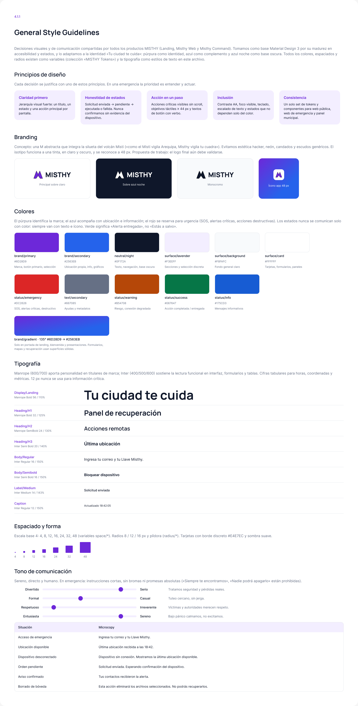</p>

#### Principios de diseño

Cada decisión se justifica con uno de estos principios. En una emergencia la prioridad es entender y actuar.

| Principio | Qué significa |
|---|---|
| Claridad primero | Jerarquía visual fuerte: un título, un estado y una acción principal por pantalla. |
| Honestidad de estados | Solicitud enviada → pendiente → ejecutada o fallida. Nunca confirmamos sin evidencia del dispositivo. |
| Acción en un paso | Acciones críticas visibles sin scroll, objetivos táctiles ≥ 44 px y textos de botón con verbo. |
| Inclusión | Contraste AA, foco visible, teclado, escalado de texto y estados que no dependen solo del color. |
| Consistencia | Un solo set de tokens y componentes para web pública, web de emergencia y panel municipal. |

#### Branding

Concepto: una M abstracta que integra la silueta del volcán Misti («como el Misti vigila Arequipa, Misthy vigila tu cuadra»). Evitamos estética hacker, neón, candados y escudos genéricos. El isotipo funciona a una tinta, en claro y oscuro, y se reconoce a 48 px. Es una propuesta de trabajo: el logo final aún debe validarse.

#### Colores

El púrpura identifica la marca; el azul acompaña con ubicación e información; el rojo se reserva para urgencia (SOS, alertas críticas, acciones destructivas). Los estados nunca se comunican solo con color: siempre van con texto e ícono. Verde significa «Alerta entregada», no «Estás a salvo».

| Token | Hex | Uso |
|---|---|---|
| `brand/primary` | `#6D28D9` | Marca, botón primario, selección |
| `brand/secondary` | `#2563EB` | Ubicación propia, información, gráficos |
| `neutral/night` | `#0F172A` | Texto, navegación, base oscura |
| `surface/lavender` | `#F3EEFF` | Secciones y selección discreta |
| `surface/background` | `#F8FAFC` | Fondo general claro |
| `surface/card` | `#FFFFFF` | Tarjetas, formularios, paneles |
| `status/emergency` | `#DC2626` | SOS, alertas críticas, acciones destructivas |
| `text/secondary` | `#667085` | Ayudas y metadatos |
| `status/warning` | `#B54708` | Riesgo, conexión degradada |
| `status/success` | `#067647` | Acción completada o entregada |
| `status/info` | `#175CD3` | Mensajes informativos |
| `brand/gradient` | 135° `#6D28D9` → `#2563EB` | Solo en la portada del landing, bienvenida y presentaciones |

#### Tipografía

Manrope (600/700) aporta personalidad en titulares de marca; Inter (400/500/600) sostiene la lectura funcional en interfaz, formularios y tablas. Usamos cifras tabulares para horas, coordenadas y métricas. El tamaño de 12 px nunca se usa para información crítica.

| Estilo | Fuente | Tamaño / interlineado | Ejemplo |
|---|---|---|---|
| Display/Landing | Manrope Bold | 56 / 110 % | Tu ciudad te cuida |
| Heading/H1 | Manrope Bold | 32 / 125 % | Panel de recuperación |
| Heading/H2 | Manrope SemiBold | 24 / 130 % | Acciones remotas |
| Heading/H3 | Inter Semi Bold | 20 / 140 % | Última ubicación |
| Body/Regular | Inter Regular | 16 / 150 % | Ingresa tu correo y tu Llave Misthy. |
| Body/Semibold | Inter Semi Bold | 16 / 150 % | Bloquear dispositivo |
| Label/Medium | Inter Medium | 14 / 143 % | Solicitud enviada |
| Caption | Inter Regular | 12 / 150 % | Actualizado 18:42:05 |

#### Espaciado y forma

Escala base 4: 4, 8, 12, 16, 24, 32 y 48 px (variables `space/*`). Radios de 8, 12 y 16 px y píldora (`radius/*`). Las tarjetas llevan un borde discreto `#E4E7EC` y sombra suave.

#### Tono de comunicación

Sereno, directo y humano. En emergencia usamos instrucciones cortas, sin bromas ni promesas absolutas: frases como «Siempre te encontramos» o «Nadie podrá apagarlo» están prohibidas.

| Dimensión | Posición de MISTHY | Por qué |
|---|---|---|
| Divertido ↔ Serio | Serio | Tratamos seguridad y pérdidas reales. |
| Formal ↔ Casual | Intermedio, cercano | Tuteo cercano, sin jerga. |
| Respetuoso ↔ Irreverente | Respetuoso | Víctimas y autoridades merecen respeto. |
| Entusiasta ↔ Sereno | Sereno | Bajo pánico calmamos, no excitamos. |

| Situación | Microcopy |
|---|---|
| Acceso de emergencia | Ingresa tu correo y tu Llave Misthy. |
| Ubicación disponible | Última ubicación recibida a las 18:42. |
| Dispositivo desconectado | Dispositivo sin conexión. Mostramos la última ubicación disponible. |
| Orden pendiente | Solicitud enviada. Esperando confirmación del dispositivo. |
| Aviso confirmado | Tus contactos recibieron la alerta. |
| Borrado de bóveda | Esta acción eliminará los archivos seleccionados. No podrás recuperarlos. |

### 4.1.2. Web Style Guidelines

Estándares visuales y de interacción para interfaces web responsive. Misthy Web (emergencia y recuperación) se diseña mobile-first porque el usuario suele entrar desde un celular prestado; Misthy Command se diseña desktop-first para operadores en central. Los componentes de esta sección son componentes reales de Figma con variantes, ligados a las variables de color.

<p align="center">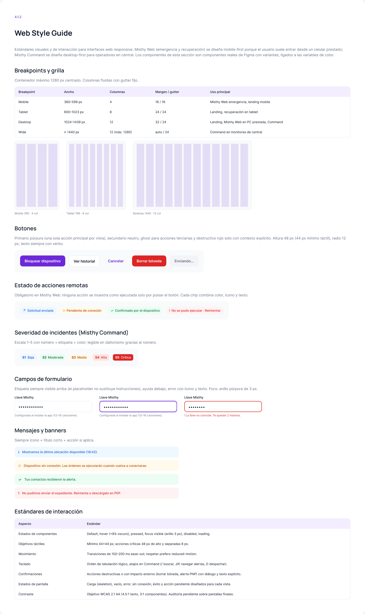</p>

#### Breakpoints y grilla

Contenedor máximo de 1280 px centrado, con columnas fluidas y gutter fijo.

| Breakpoint | Ancho | Columnas | Margen / gutter | Uso principal |
|---|---|---|---|---|
| Mobile | 360–599 px | 4 | 16 / 16 | Misthy Web emergencia, landing mobile |
| Tablet | 600–1023 px | 8 | 24 / 24 | Landing, recuperación en tablet |
| Desktop | 1024–1439 px | 12 | 32 / 24 | Landing, Misthy Web en PC prestada, Command |
| Wide | ≥ 1440 px | 12 (máx. 1280) | auto / 24 | Command en monitores de central |

#### Componentes

- **Botones:** primario púrpura (una sola acción principal por vista), secundario neutro, ghost para acciones terciarias y destructivo rojo solo con contexto explícito. Altura de 48 px (44 px mínimo táctil), radio de 12 px y texto siempre con verbo.
- **Estado de acciones remotas:** obligatorio en Misthy Web. Ninguna acción se muestra como ejecutada solo por pulsar el botón. Cada chip combina color, ícono y texto: *Solicitud enviada*, *Pendiente de conexión*, *Confirmado por el dispositivo* y *No se pudo ejecutar · Reintentar*.
- **Severidad de incidentes (Misthy Command):** escala del 1 al 5 con número, etiqueta y color (S1 Baja, S2 Moderada, S3 Media, S4 Alta, S5 Crítica). El número la hace legible para personas con daltonismo.
- **Campos de formulario:** etiqueta siempre visible arriba (el placeholder no sustituye instrucciones), ayuda debajo y error con ícono y texto. El foco es un anillo púrpura de 3 px.
- **Mensajes y banners:** siempre ícono, título corto y acción si aplica.

#### Estándares de interacción

| Aspecto | Estándar |
|---|---|
| Estados de componentes | Default, hover (+8 % oscuro), pressed, focus visible (anillo de 3 px), disabled y loading. |
| Objetivos táctiles | Mínimo 44×44 px; acciones críticas de 48 px de alto y separadas 8 px. |
| Movimiento | Transiciones de 150–200 ms ease-out; se respeta `prefers-reduced-motion`. |
| Teclado | Orden de tabulación lógico y atajos en Command (`/` buscar, `J`/`K` navegar alertas, `D` despachar). |
| Confirmaciones | Acciones destructivas o con impacto externo (borrar bóveda, alerta a la PNP) piden diálogo y texto explícito. |
| Estados de pantalla | Carga (skeleton), vacío, error, sin conexión, éxito y acción pendiente diseñados para cada vista. |
| Contraste | Objetivo WCAG 2.1 AA (4.5:1 en texto, 3:1 en componentes). La auditoría sobre las pantallas finales está pendiente. |

---

## 4.2. Information Architecture

### 4.2.1. Organization Systems

Cómo se agrupa y ordena el contenido en el Landing Page, Misthy Web y Misthy Command para que cada visitante encuentre lo que necesita sin esfuerzo, incluso bajo estrés. Usamos organización jerárquica cuando hay que priorizar, secuencial cuando hay que completar pasos bajo presión y matricial cuando el usuario compara o monitorea muchos registros a la vez.

| Grupo de información | Producto | Organización visual | Sustento |
|---|---|---|---|
| Secciones del landing (hero, problema, cómo funciona, productos, planes, aliados, FAQ, contacto) | Landing | Jerárquica | Narrativa de arriba hacia abajo: propuesta de valor y CTA primero, detalle después (patrón Z en el hero, F en el contenido). |
| Acceso de emergencia (correo → Llave Misthy → panel) | Misthy Web | Secuencial | Bajo pánico, un paso y una acción por pantalla reduce errores. |
| Panel de recuperación (estado del equipo, mapa, acciones remotas) | Misthy Web | Jerárquica | Primero el estado y la última ubicación; luego las acciones ordenadas por urgencia (bloquear, sirena, bóveda, PNP, contactos). |
| Acciones destructivas (borrar bóveda, enviar a la PNP) | Misthy Web | Secuencial | Revisar → confirmar con 2FA → ver resultado; evita acciones irreversibles por error. |
| Monitor en vivo (mapa + cola de alertas) | Command | Matricial | El operador cruza ubicación, severidad y tiempo en simultáneo: mapa a la izquierda, lista a la derecha. |
| Analítica (KPIs, horas, zonas, tipos de delito) | Command | Matricial | Tableros comparativos por eje hora × zona × tipo. |
| Despacho de serenos y bandeja PNP | Command | Secuencial | Asignar → en camino → en sitio → cerrado; expediente: recibido → revisado → exportado. |

**Esquemas de categorización.** Cada listado usa el esquema que coincide con la pregunta que el usuario se hace al mirarlo.

| Esquema | Dónde se aplica | Ejemplo |
|---|---|---|
| Cronológico | Historial de ruta, alertas en vivo, actividad del dispositivo, expedientes PNP | «18:42 Última ubicación recibida»; alertas más recientes arriba. |
| Por tópicos | Landing (Ciudadanos / Comunidades / Municipalidades), tipos de incidente, FAQ | Robo al paso, asalto, acoso, sospechoso. |
| Según audiencia | Landing y planes (Ciudadano, Junta vecinal, Universidad, Municipalidad); roles de Command (operador, supervisor, admin) | Menú «Soluciones» con una página por audiencia. |
| Alfabético | Contactos de confianza, sectores y cuadrantes, serenos, Puntos Misthy | Sector 1… Sector 10; contactos A–Z. |
| Por severidad (ordinal) | Cola de alertas de Command | S5 Crítica arriba, luego por antigüedad. |

### 4.2.2. Labeling Systems

Etiquetas con el mínimo de palabras, en español peruano neutro, con verbo en las acciones y sustantivo en las secciones. Un mismo concepto se nombra igual en los tres productos.

**Landing Page**

| Etiqueta | Representa | Asociación que genera |
|---|---|---|
| Cómo funciona | Explicación en 3 pasos | Entender el servicio antes de descargar. |
| Soluciones | Páginas por audiencia | «Hay algo para mí» (ciudadano, junta, municipalidad). |
| Planes | Precios Free / Pro / Organizaciones | Costo y comparativa. |
| Misthy Command | Producto B2B/B2G | Demo para municipalidades. |
| Emergencia | Acceso a `misthy.app/emergencia` | «Me robaron, entro aquí» (botón rojo en el header). |
| Descargar app | Tiendas móviles | CTA primario. |
| Contacto | Formulario, correo, redes | Información de contacto sin saturar el header. |

**Misthy Web**

| Etiqueta | Representa | Asociación que genera |
|---|---|---|
| Llave Misthy | Clave secreta de 12–16 caracteres | Credencial distinta de la contraseña, solo para emergencias. |
| Mi dispositivo | Estado del celular (conexión, batería, última ubicación) | Situación actual. |
| Ubicación | Mapa en vivo e historial | ¿Dónde está mi equipo? |
| Bloquear | Lockdown remoto | Proteger el equipo. |
| Sirena | Alarma sonora remota | Ubicar el equipo cerca. |
| Bóveda | Documentos cifrados | Congelar o borrar archivos. |
| Avisar a PNP | Envío de expediente a comisaría o serenazgo | Denuncia con evidencia. |
| Contactos | Red de confianza | Avisar a mi gente. |

**Misthy Command**

| Etiqueta | Representa | Asociación que genera |
|---|---|---|
| Monitor | Mapa distrital y cola de alertas | Trabajo en vivo. |
| Alertas | Incidentes entrantes con severidad S1–S5 | Priorizar. |
| Despachar | Asignar sereno o unidad | Acción del operador. |
| Reportes | Reportes comunitarios por verificar | Moderación. |
| Expedientes PNP | Bandeja de PDF probatorios | Coordinación policial. |
| Analítica | Patrones, predicción y reportes | Decisiones de gestión. |
| Administración | Roles, cobertura, facturación | Configuración. |

### 4.2.3. SEO Tags and Meta Tags

El Landing (`misthy.pe`) se indexa y optimiza para búsquedas locales («app seguridad ciudadana Lima», «recuperar celular robado»). Las vistas de Misthy Web y Misthy Command contienen datos personales o de operación, por eso llevan `noindex` y solo exponen title y description para compartir el enlace con seguridad.

**Landing · Inicio** (`https://misthy.pe/`)

```html
<html lang="es-PE">
<title>MISTHY | Seguridad ciudadana en red para Lima</title>
<meta name="description" content="Alerta, ubica y recupera. MISTHY conecta a vecinos, serenazgo y PNP con botón de pánico, mapa de incidentes y recuperación de celular robado.">
<meta name="keywords" content="seguridad ciudadana, app de pánico, celular robado, Lima, Villa El Salvador, serenazgo, alerta vecinal">
<meta name="author" content="MISTHY">
<meta name="robots" content="index, follow">
<meta name="viewport" content="width=device-width, initial-scale=1">
<link rel="canonical" href="https://misthy.pe/">
<meta property="og:title" content="MISTHY · Tu ciudad te cuida">
<meta property="og:description" content="Seguridad ciudadana en red para Lima.">
<meta property="og:image" content="https://misthy.pe/og/cover.png">
```

**Landing · Misthy Command** (`https://misthy.pe/command`)

```html
<title>Misthy Command | Monitoreo de seguridad para municipalidades</title>
<meta name="description" content="Panel de monitoreo en vivo, despacho de serenazgo, analítica predictiva e integración con la PNP para gobiernos locales.">
<meta name="keywords" content="software serenazgo, monitoreo municipal, seguridad ciudadana B2G, mapa del delito, Perú">
<meta name="author" content="MISTHY">
<meta name="robots" content="index, follow">
<link rel="canonical" href="https://misthy.pe/command">
```

**Landing · Planes** (`https://misthy.pe/planes`)

```html
<title>Planes MISTHY | Gratis, Pro y Organizaciones</title>
<meta name="description" content="Compara Misthy Free, Misthy Pro y planes para juntas vecinales, universidades y municipalidades.">
<meta name="keywords" content="precio app seguridad, Misthy Pro, plan junta vecinal, seguridad condominio">
<meta name="author" content="MISTHY">
<meta name="robots" content="index, follow">
```

**Misthy Web · Acceso de emergencia** (`https://misthy.app/emergencia`)

```html
<title>Acceso de emergencia | MISTHY</title>
<meta name="description" content="¿Te robaron el celular? Ingresa con tu correo y tu Llave Misthy para ubicarlo y protegerlo.">
<meta name="keywords" content="celular robado, bloquear celular, ubicar celular, Misthy">
<meta name="author" content="MISTHY">
<meta name="robots" content="index, nofollow">
<meta name="referrer" content="no-referrer">
```

**Misthy Web · Panel de recuperación** (`https://misthy.app/panel`)

```html
<title>Panel de recuperación | MISTHY</title>
<meta name="description" content="Ubicación y acciones remotas de tu dispositivo.">
<meta name="keywords" content="panel de recuperación, Misthy">
<meta name="author" content="MISTHY">
<meta name="robots" content="noindex, nofollow, noarchive">
<meta http-equiv="Cache-Control" content="no-store">
```

**Misthy Command · App** (`https://command.misthy.app`)

```html
<title>Misthy Command | Monitor en vivo</title>
<meta name="description" content="Centro de monitoreo y despacho para serenazgo.">
<meta name="keywords" content="Misthy Command, monitor, serenazgo">
<meta name="author" content="MISTHY">
<meta name="robots" content="noindex, nofollow, noarchive">
```

### 4.2.4. Searching Systems

Medios de búsqueda para que el usuario no se pierda entre el volumen de información. El Landing es corto y no requiere buscador (la navegación y el FAQ filtrable bastan). Misthy Web prioriza búsquedas acotadas en el historial y la bóveda. Misthy Command, que maneja miles de registros, ofrece búsqueda global con filtros facetados.

| Producto / vista | Búsqueda | Filtros | Cómo se muestran los resultados |
|---|---|---|---|
| Landing · FAQ | Campo «Busca tu duda» con sugerencias | Tema: Ciudadanos, Comunidades, Municipalidades, Privacidad | Acordeones filtrados con la coincidencia resaltada; vacío: «No encontramos esa pregunta · Escríbenos». |
| Misthy Web · Historial de ubicación | Por fecha/hora o dirección | Rango (última hora, hoy, 24 h), tipo de evento (ubicación, apagado, orden remota) | Línea de tiempo cronológica y pines numerados en el mapa sincronizados con la lista. |
| Misthy Web · Bóveda | Por nombre de archivo | Tipo (DNI, foto, audio, PDF), fecha | Lista con checkbox para congelar o borrar en lote; contador de seleccionados. |
| Command · Búsqueda global (atajo `/`) | Código de alerta, dirección, DNI de ciudadano, placa, sereno | — | Resultados agrupados por tipo (Alertas, Ciudadanos, Serenos, Expedientes) con los 3 primeros y «ver todos». |
| Command · Monitor / Alertas | Texto libre en la cola | Severidad S1–S5, estado (nueva, asignada, en sitio, cerrada), sector/cuadrante, tipo de incidente, rango horario | Cola ordenada por severidad y antigüedad; chips de filtros activos removibles; el mapa muestra solo lo filtrado. |
| Command · Reportes comunitarios | Texto libre | Estado de verificación, tipo, sector, con evidencia (sí/no) | Tarjetas con miniatura de evidencia y botones Verificar / Descartar. |
| Command · Expedientes PNP | N.º de expediente o DNI | Comisaría, estado (recibido, revisado, exportado), fecha | Tabla paginada con exportación a PDF/CSV. |

**Patrón visual de búsqueda en Command:** barra de búsqueda persistente en el header, filtros como chips bajo la barra y contador de resultados. El estado vacío sugiere limpiar filtros.

<p align="center">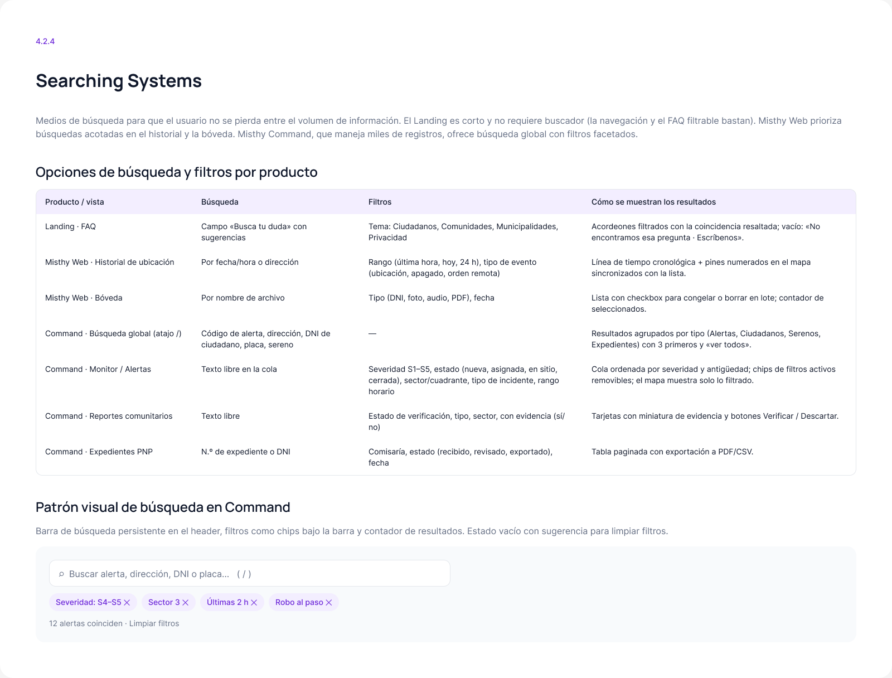</p>

### 4.2.5. Navigation Systems

Acciones y técnicas que guían a los usuarios. El Landing usa navegación global con anclas y CTA persistente. Misthy Web usa navegación lineal en el acceso y navegación local por pestañas en el panel. Command usa navegación global lateral fija con navegación contextual (paneles de detalle) para no perder el mapa.

<p align="center">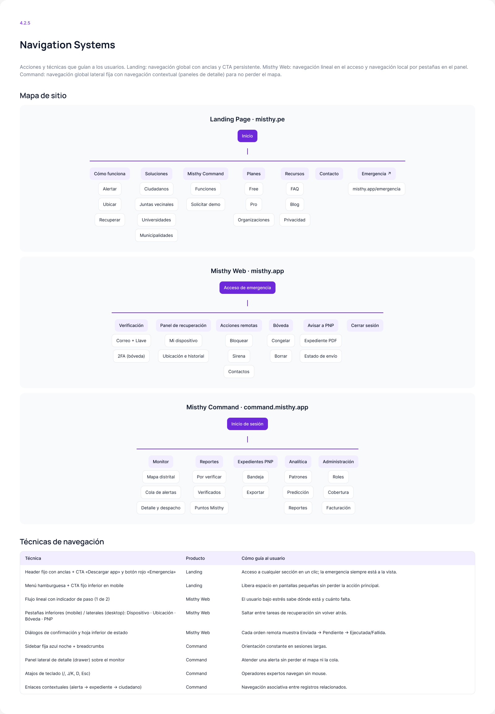</p>

| Técnica | Producto | Cómo guía al usuario |
|---|---|---|
| Header fijo con anclas, CTA «Descargar app» y botón rojo «Emergencia» | Landing | Acceso a cualquier sección en un clic; la emergencia siempre está a la vista. |
| Menú hamburguesa y CTA fijo inferior en mobile | Landing | Libera espacio en pantallas pequeñas sin perder la acción principal. |
| Flujo lineal con indicador de paso (1 de 2) | Misthy Web | El usuario bajo estrés sabe dónde está y cuánto falta. |
| Pestañas inferiores (mobile) o laterales (desktop): Dispositivo · Ubicación · Bóveda · PNP | Misthy Web | Saltar entre tareas de recuperación sin volver atrás. |
| Diálogos de confirmación y hoja inferior de estado | Misthy Web | Cada orden remota muestra Enviada → Pendiente → Ejecutada/Fallida. |
| Sidebar fija azul noche y breadcrumbs | Command | Orientación constante en sesiones largas. |
| Panel lateral de detalle (drawer) sobre el monitor | Command | Atender una alerta sin perder el mapa ni la cola. |
| Atajos de teclado (`/`, `J`/`K`, `D`, `Esc`) | Command | Operadores expertos navegan sin mouse. |
| Enlaces contextuales (alerta → expediente → ciudadano) | Command | Navegación asociativa entre registros relacionados. |

---

## 4.3. Landing Page UI Design

El landing (`misthy.pe`) traduce las decisiones de diseño y arquitectura de información en una narrativa jerárquica: propuesta de valor y CTA arriba (Descargar app / Soy municipalidad), luego problema → cómo funciona → productos → acceso de emergencia → planes → piloto → FAQ → contacto. El botón rojo «Emergencia» vive en el header en todas las resoluciones porque el visitante más urgente es quien acaba de perder su celular.

| Decisión | Aplicación en el landing |
|---|---|
| Organización jerárquica y por audiencia | Secciones en orden de importancia; «Soluciones» separa ciudadanos, comunidades y municipalidades. |
| Labeling mínimo | Navegación con 5 etiquetas: Cómo funciona, Soluciones, Misthy Command, Planes, Contacto. |
| Navegación | Header fijo con anclas; en mobile, menú hamburguesa y CTA fijo inferior. |
| Style guidelines | Degradado de marca solo en el hero; secciones sólidas; rojo reservado a Emergencia. |
| Diseño inclusivo | Contraste AA, textos ≥ 16 px, objetivos de 48 px, FAQ navegable con teclado, imágenes con texto alternativo. |
| SEO | H1 único «Tu ciudad te cuida», meta description y keywords definidas en 4.2.3. |

### 4.3.1. Landing Page Wireframe

Wireframes de fidelidad media en escala de grises con copy real, para validar estructura y jerarquía antes del color.

<table>
  <tr>
    <th>Desktop Web Browser (1440 px)</th>
    <th>Mobile Web Browser (390 px)</th>
  </tr>
  <tr>
    <td valign="top">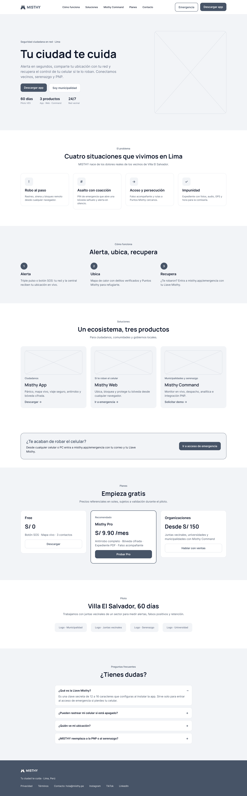</td>
    <td valign="top">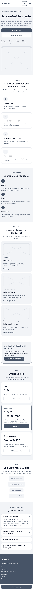</td>
  </tr>
</table>

| Principio | Aplicación |
|---|---|
| Jerarquía | Un único H1 y un CTA primario por bloque; tamaño y peso guían la lectura en Z (hero) y en F (contenido). |
| Proximidad y agrupación | Tarjetas con padding de 24 px agrupan ícono, título y descripción; 96 px separan secciones. |
| Repetición | Mismo patrón eyebrow + título + subtítulo en cada sección para crear ritmo. |
| Contraste | La acción Emergencia se distingue por borde y ubicación fija, no solo por color. |
| Diseño inclusivo | Texto mínimo de 16 px, botones de 48 px, orden de foco igual al visual, FAQ como acordeón accesible. |
| Responsive | En mobile las grillas de 3–4 columnas pasan a 1 columna, el menú se colapsa y el CTA queda fijo abajo. |
| Arquitectura de información | Las secciones siguen el mapa de sitio de 4.2.5 y las etiquetas de 4.2.2. |

### 4.3.2. Landing Page Mock-up

Mock-ups en alta fidelidad aplicando el Design System MISTHY (variables de color, estilos de texto Manrope/Inter, escala de espaciado 4–48 y radios 12–16).

<table>
  <tr>
    <th>Desktop Web Browser (1440 px)</th>
    <th>Mobile Web Browser (390 px)</th>
  </tr>
  <tr>
    <td valign="top">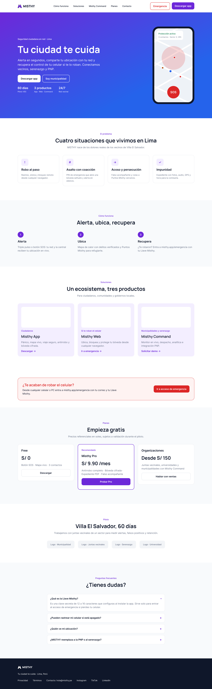</td>
    <td valign="top">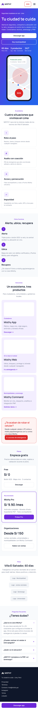</td>
  </tr>
</table>

| Decisión | Aplicación |
|---|---|
| Identidad | Degradado púrpura → azul solo en el hero; el resto usa superficies sólidas para no competir con el contenido. |
| Color con significado | Púrpura = acciones y marca; azul = ubicación propia; rojo = únicamente Emergencia y SOS. |
| Tipografía | Manrope Bold para titulares de marca (64/36 px); Inter para lectura (16–20 px). |
| Ilustración de producto | El celular muestra mapa de calor, ubicación propia en azul, estado «Protección activa» con texto y el SOS. |
| Confianza y honestidad | Precios marcados como referenciales; sin promesas absolutas («Siempre te encontramos»). |
| Accesibilidad | Texto blanco sobre degradado ≥ 4.5:1 en titulares, foco visible en botones, CTA fijo en mobile al alcance del pulgar. |
| Design System | Botones, chips y tarjetas reutilizan los componentes y tokens de 4.1.2. |

---

## 4.4. Web Applications UX/UI Design

Propuesta visual y de interacción para las dos aplicaciones web del alcance:

- **Misthy Web** (ciudadano): acceso de emergencia y panel de recuperación. Es mobile-first porque normalmente se entra desde un celular prestado, y tiene versión desktop.
- **Misthy Command** (operadores de serenazgo y gestión municipal): desktop.

**User personas usadas en los flujos**

| Persona | Perfil |
|---|---|
| Lucía Rojas | 32 años, vendedora en Villa El Salvador, víctima de robo de celular. |
| Carlos Mendoza | Operador de serenazgo en la central. |
| Rosa Huamán | Supervisora de gestión comunitaria. |

### 4.4.1. Web Applications Wireframes

Wireframes de fidelidad media en escala de grises con copy real (prefijo **WF** en Figma).

**Misthy Web · Mobile Web Browser (390 px)**

<p align="center">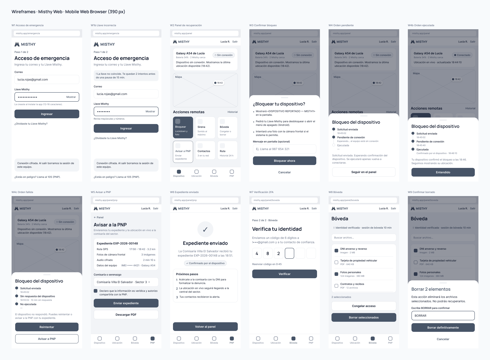</p>

**Misthy Web · Desktop Web Browser (1440 px)**

<p align="center">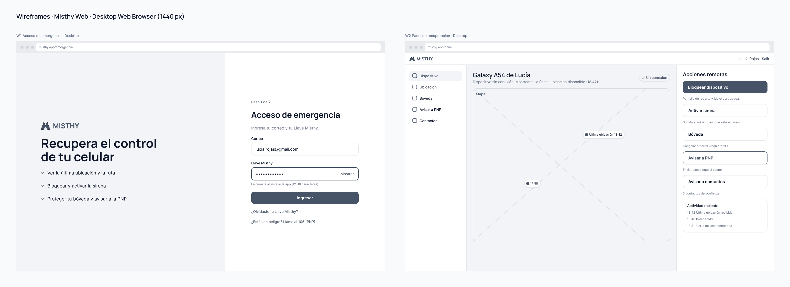</p>

**Misthy Command · Desktop Web Browser (1440 px)**

<p align="center">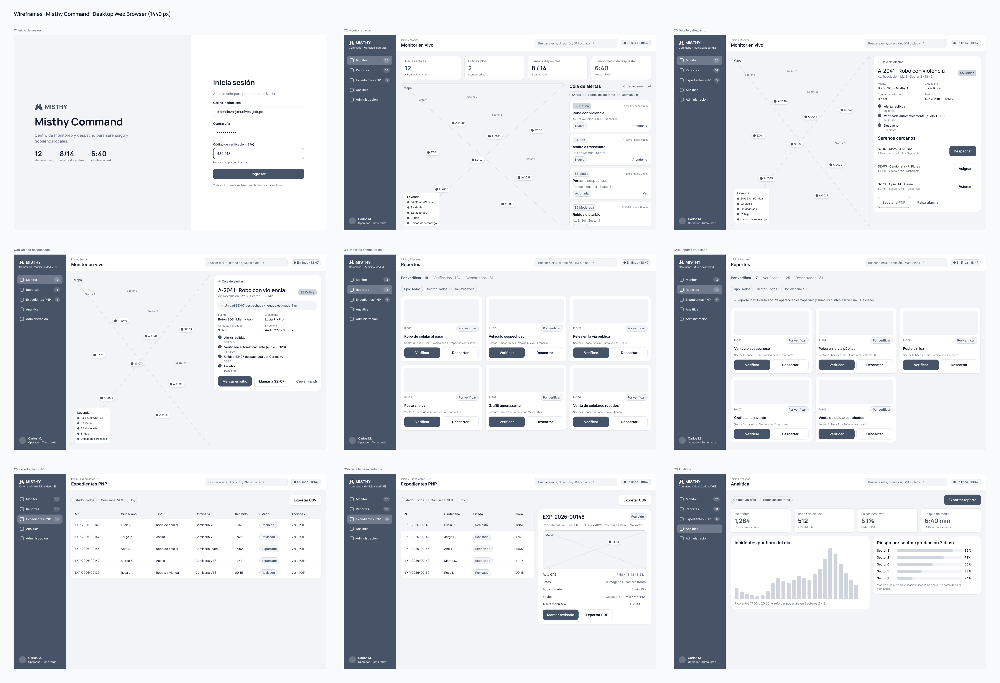</p>

| Pantallas | Contenido |
|---|---|
| W1 – W1b | Acceso con correo + Llave Misthy (estado normal y error). |
| W2 | Panel de recuperación. |
| W3 | Confirmación de bloqueo. |
| W4 / W4b / W4c | Estados de la orden: pendiente, ejecutada, fallida. |
| W5 – W6 | Aviso a la PNP y expediente enviado. |
| W7 – W9 | Bóveda con 2FA y borrado. |
| C1 | Login con 2FA. |
| C2 | Monitor (mapa + cola por severidad). |
| C3 / C3b | Detalle de alerta y despacho. |
| C4 / C4b | Verificación de reportes comunitarios. |
| C5 / C5b | Expedientes PNP. |
| C6 | Analítica. |

- **Principios:** jerarquía (estado del equipo y última ubicación primero; una acción principal por paso), proximidad (acciones remotas agrupadas en una grilla) y consistencia (la misma barra inferior en todas las vistas del panel).
- **Diseño inclusivo:** etiquetas visibles, ayudas bajo los campos, objetivos ≥ 44 px, estados con texto + ícono (no solo color) y número de emergencia visible.
- **Arquitectura de información:** navegación lineal en el acceso («Paso 1 de 2») y local por pestañas (Dispositivo · Ubicación · Bóveda · PNP) según 4.2.5, con las etiquetas de 4.2.2. Command usa organización matricial para cruzar ubicación, severidad y tiempo.

### 4.4.2. Web Applications Wireflow Diagrams

Cada wireflow parte de un user goal y une los wireframes con la interacción que lleva de una pantalla a la siguiente.

**WF1 · Bloquear el celular robado**
User persona: Lucía (ciudadana).
User goal: *Como ciudadana a quien le robaron el celular, quiero bloquearlo desde un navegador prestado para que el ladrón no pueda usarlo.*
Lucía entra a `misthy.app/emergencia`, ingresa correo y Llave Misthy y llega al panel. Toca «Bloquear», revisa qué ocurrirá y confirma. La orden queda «Pendiente de conexión» y cambia a «Confirmado por el dispositivo» cuando el equipo se conecta.

<p align="center">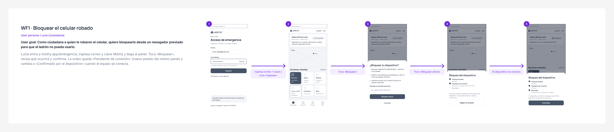</p>

**WF2 · Avisar a la PNP con expediente**
User persona: Lucía (ciudadana).
User goal: *Como ciudadana víctima de robo, quiero enviar mi expediente con evidencias a la comisaría para iniciar la denuncia.*
Desde el panel toca «Avisar a PNP», revisa el expediente generado (ruta, fotos, audio, datos del equipo), elige la comisaría del sector, acepta la declaración y envía. Recibe confirmación con código y próximos pasos.

<p align="center">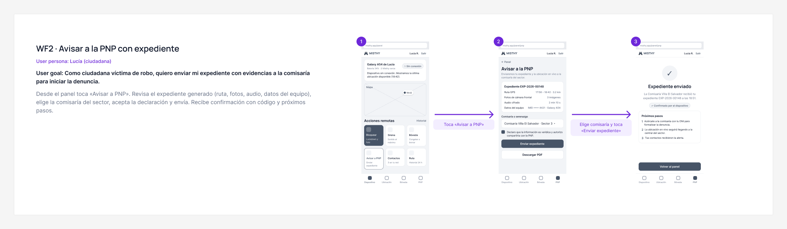</p>

**WF3 · Proteger la bóveda**
User persona: Lucía (ciudadana).
User goal: *Como ciudadana, quiero borrar o congelar mis documentos sensibles para que nadie los use si desbloquean el equipo.*
Toca «Bóveda»; por ser una acción sensible se pide 2FA (paso 2 de 2). Con el código válido ve sus archivos, selecciona DNI y fotos y toca «Borrar seleccionados». Un diálogo explica que es irreversible y pide escribir BORRAR.

<p align="center">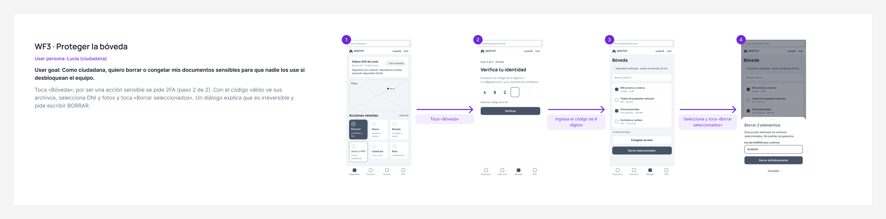</p>

**WF4 · Atender una alerta crítica y despachar**
User persona: Carlos (operador de serenazgo).
User goal: *Como operador de serenazgo, quiero atender la alerta más grave y enviar al sereno más cercano para reducir el tiempo de respuesta.*
Carlos inicia sesión con 2FA y ve el monitor con la cola ordenada por severidad. Abre A-2041 (S5); el detalle se abre junto al mapa con evidencia y serenos cercanos. Despacha SZ-07 y la vista cambia al estado «despachada» con ruta y tiempo estimado de llegada.

<p align="center">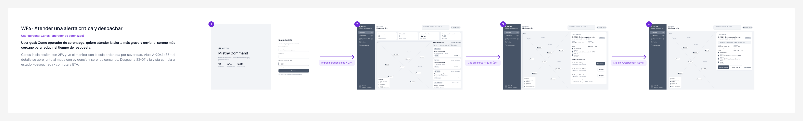</p>

**WF5 · Verificar un reporte comunitario**
User persona: Rosa (supervisora comunitaria).
User goal: *Como supervisora, quiero validar los reportes vecinales con evidencia para publicar solo información confiable en el mapa.*
Desde el monitor entra a «Reportes», filtra por evidencia, revisa R-311 (vecina con buena reputación y foto) y toca «Verificar». Un banner confirma la publicación y ofrece deshacer.

<p align="center">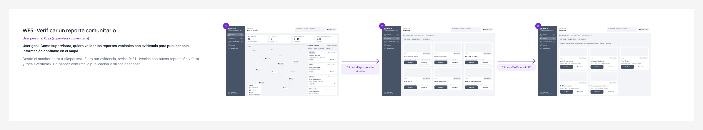</p>

**WF6 · Revisar y exportar un expediente PNP**
User persona: Carlos (operador / enlace PNP).
User goal: *Como operador, quiero revisar el expediente que envió una ciudadana y exportarlo para la comisaría.*
Entra a «Expedientes PNP», abre EXP-2026-00148 desde la tabla y ve el detalle lateral con ruta, evidencias y alerta vinculada. Lo marca revisado o lo exporta en PDF.

<p align="center">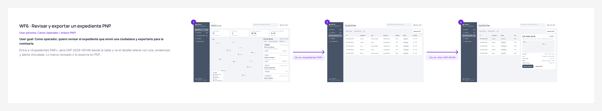</p>

### 4.4.3. Web Applications Mock-ups

Mock-ups en alta fidelidad con el Design System MISTHY (prefijo **MU** en Figma). Son las mismas pantallas que los wireframes, ahora con tokens de color, tipografía Manrope/Inter y los componentes de 4.1.2.

**Misthy Web · Mobile Web Browser (390 px)**

<p align="center">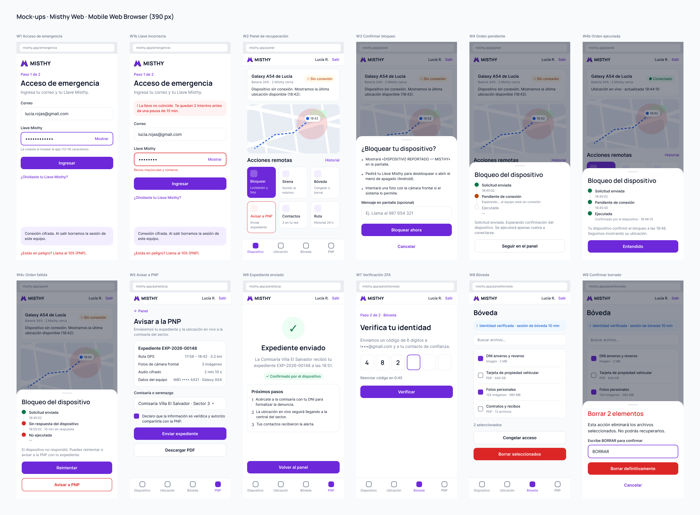</p>

**Misthy Web · Desktop Web Browser (1440 px)**

<p align="center">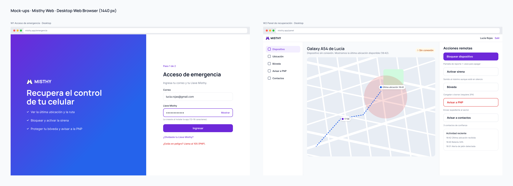</p>

**Misthy Command · Desktop Web Browser (1440 px)**

<p align="center">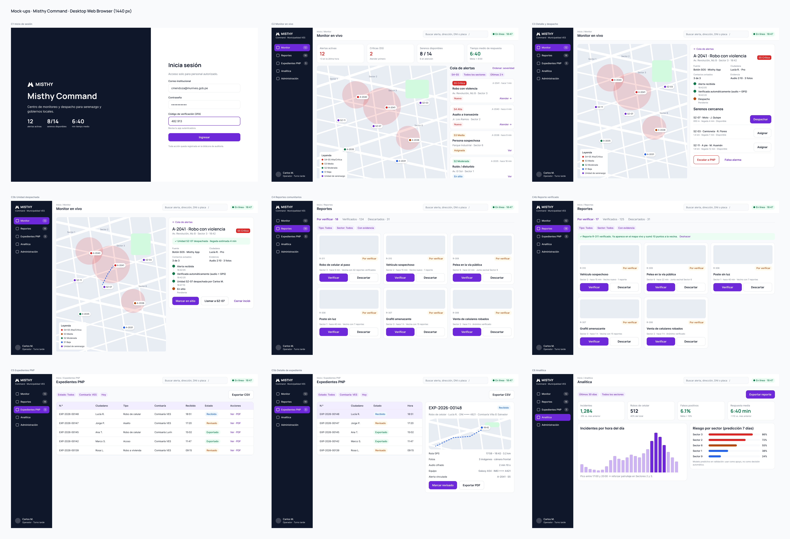</p>

| Decisión | Aplicación |
|---|---|
| Color con propósito | Púrpura para la acción principal (Bloquear, Despachar, Verificar); azul para la ubicación propia y la ruta; rojo solo para PNP, borrado y severidades altas. |
| Honestidad de estados | Chips «Sin conexión», «Pendiente de conexión», «Confirmado por el dispositivo» y «No se pudo ejecutar»; nunca se muestra «bloqueado» sin confirmación. |
| Densidad por producto | Misthy Web: pocas opciones, mucho aire, una acción por hoja. Command: sidebar azul noche, KPIs, mapa y cola en paralelo para operadores expertos. |
| Accesibilidad | Severidad con número + texto (S5 Crítica); leyenda del mapa; foco visible; contraste AA en texto sobre púrpura y azul noche. |
| Design System | Botones, chips de estado, badges de severidad y campos reutilizan los componentes y variables de 4.1. |

### 4.4.4. Web Applications User Flow Diagrams

Cada diagrama muestra el happy path (línea púrpura continua), los unhappy paths (línea roja discontinua) y los puntos de decisión (rombos), sobre los mock-ups de 4.4.3.

**UF1 · Bloquear el celular robado** · Persona: Lucía (ciudadana)
User goal: *Como ciudadana a quien le robaron el celular, quiero bloquearlo desde un navegador prestado para que el ladrón no pueda usarlo.*
- **Happy path:** acceso con Llave correcta → panel → confirmar bloqueo → el equipo está conectado y confirma.
- **Unhappy paths:** (1) Llave incorrecta: mensaje con intentos restantes y, tras 3 fallos, pausa de 15 min con aviso al correo. (2) Equipo sin conexión: la orden queda «Pendiente de conexión» y se ejecuta al reconectarse; si en 10 min no responde se muestra «No se pudo ejecutar» con opciones de reintentar o avisar a la PNP.

<p align="center">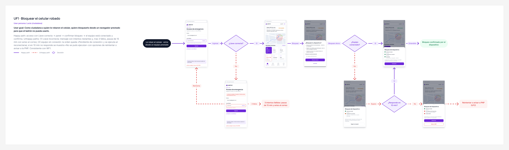</p>

**UF2 · Avisar a la PNP con expediente** · Persona: Lucía (ciudadana)
User goal: *Como ciudadana víctima de robo, quiero enviar mi expediente con evidencias a la comisaría para iniciar la denuncia.*
- **Happy path:** panel → «Avisar a PNP» → revisar expediente, elegir comisaría y aceptar declaración → envío exitoso con código.
- **Unhappy paths:** sin aceptar la declaración el botón queda deshabilitado; si falla el envío se muestra un error con «Reintentar» y la alternativa «Descargar PDF» para llevarlo a la comisaría.

<p align="center">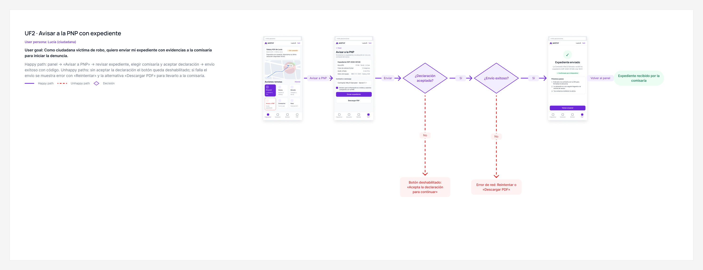</p>

**UF3 · Proteger la bóveda** · Persona: Lucía (ciudadana)
User goal: *Como ciudadana, quiero borrar o congelar mis documentos sensibles para que nadie los use si desbloquean el equipo.*
- **Happy path:** panel → «Bóveda» → código 2FA válido → seleccionar archivos → «Borrar seleccionados» → escribir BORRAR → archivos eliminados. Ruta alternativa: «Congelar acceso» (reversible).
- **Unhappy paths:** código inválido (reenviar; tras 3 errores la bóveda se bloquea 30 min) y confirmación incompleta (el botón destructivo sigue deshabilitado).

<p align="center">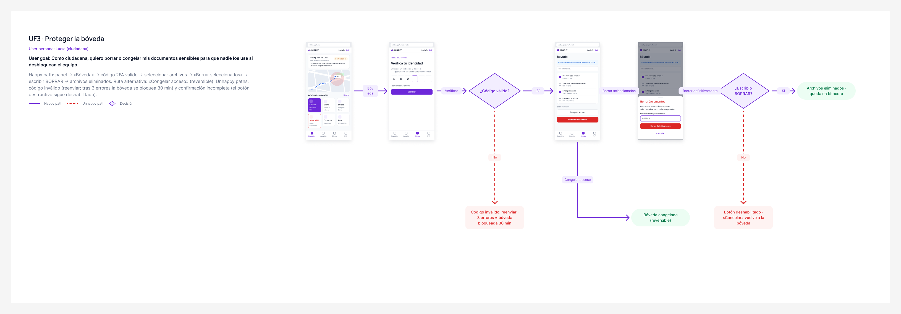</p>

**UF4 · Atender una alerta crítica y despachar** · Persona: Carlos (operador de serenazgo)
User goal: *Como operador de serenazgo, quiero atender la alerta más grave y enviar al sereno más cercano para reducir el tiempo de respuesta.*
- **Happy path:** login + 2FA → monitor → abrir A-2041 (S5) → despachar SZ-07 → unidad en camino y luego en sitio.
- **Unhappy paths:** 2FA inválido (error y bloqueo tras 5 intentos) y sin serenos disponibles (escalar a la PNP o asignar una unidad de otro sector). «Falsa alarma» cierra la alerta con motivo.

<p align="center">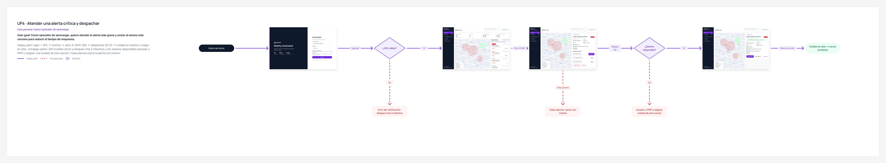</p>

**UF5 · Verificar un reporte comunitario** · Persona: Rosa (supervisora comunitaria)
User goal: *Como supervisora, quiero validar los reportes vecinales con evidencia para publicar solo información confiable en el mapa.*
- **Happy path:** monitor → «Reportes» → revisar R-311 → evidencia suficiente y no duplicada → «Verificar» → publicado en el mapa con puntos para la vecina (con opción de deshacer).
- **Unhappy path:** evidencia insuficiente o duplicado → «Descartar» con motivo y notificación al vecino.

<p align="center">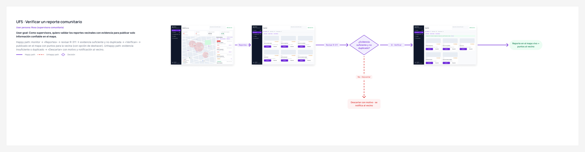</p>

**UF6 · Revisar y exportar un expediente PNP** · Persona: Carlos (operador / enlace PNP)
User goal: *Como operador, quiero revisar el expediente que envió una ciudadana y exportarlo para la comisaría.*
- **Happy path:** monitor → «Expedientes PNP» → «Ver» EXP-00148 → expediente completo → «Exportar PDF» / «Marcar revisado».
- **Unhappy path:** si falta información (por ejemplo DNI o audio) se solicita a la ciudadana y el estado queda «Recibido».

<p align="center">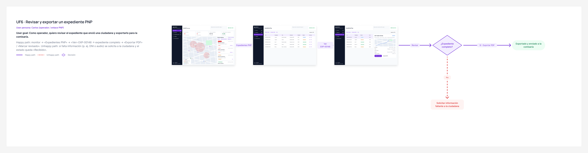</p>

---

## 4.5. Web Applications Prototyping

Prototipos navegables en Figma para Mobile Web Browser (Misthy Web, 390 px) y Desktop Web Browser (Misthy Web 1440 px y Misthy Command 1440 px). Siguen los happy paths de los User Flow Diagrams (4.4.4) y usan los mock-ups de 4.4.3. Para reproducirlos: abrir el archivo, ir a la página **4.5 Web Applications Prototyping**, pulsar **Present (▶)** y elegir el flujo en el panel de Flows, o usar los enlaces directos de la tabla inicial.

<p align="center">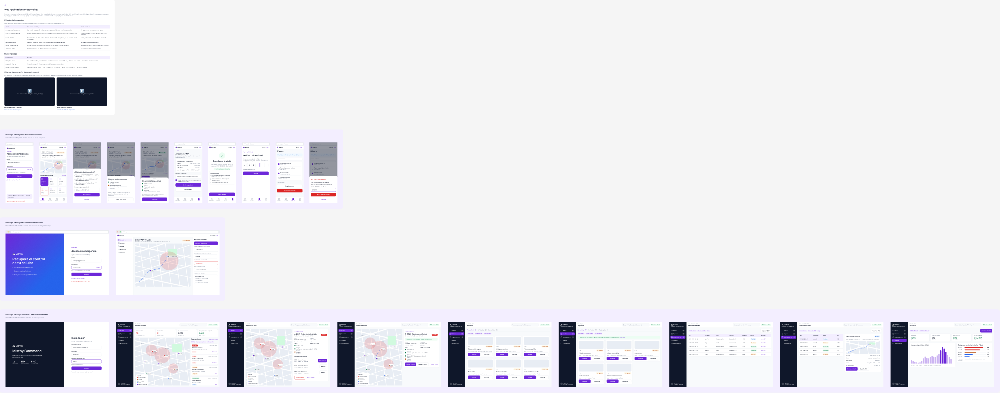</p>

**Criterios de interacción.** Cada interacción responde a una decisión de arquitectura de información y del sistema de navegación (4.2.5).

| Criterio | Aplicación en el prototipo | Relación con la arquitectura de información |
|---|---|---|
| Una acción principal por paso | El acceso de emergencia lleva directo al panel; cada hoja inferior tiene un solo botón primario. | Navegación lineal con indicador «Paso 1 de 2». |
| Hojas inferiores para confirmar | Bloquear, estado de la orden y borrar bóveda se abren como hoja sobre el panel (Smart Animate 250 ms). | El usuario no pierde el contexto del panel (organización jerárquica). |
| Estados honestos | Tras «Bloquear ahora» el prototipo muestra «Pendiente de conexión» y, a los 2,5 s, simula la confirmación del dispositivo. | Labeling: Solicitud enviada → Pendiente → Ejecutada. |
| Pestañas persistentes | Dispositivo · Ubicación · Bóveda · PNP funcionan desde cualquier vista del panel. | Navegación local por pestañas (4.2.5). |
| Sidebar + panel de detalle | En Command el detalle de la alerta aparece junto al mapa; el sidebar cambia de módulo. | Navegación global fija + contextual; organización matricial. |
| Transiciones cortas | Smart Animate / ease-out 250 ms; sin animaciones decorativas. | Respeto a la reducción de movimiento (4.1.2). |

**Flujos incluidos**

| Flujo (Present) | Recorrido |
|---|---|
| Misthy Web · Mobile | Acceso → Panel → Bloquear → Pendiente → Confirmado → Panel · Avisar a PNP → Expediente enviado · Bóveda → 2FA → Borrar → Confirmar borrado. |
| Misthy Web · Desktop | Acceso de emergencia → Panel de recuperación (navegación lateral) → Salir. |
| Misthy Command · Desktop | Login 2FA → Monitor → Alerta A-2041 → Despachar SZ-07 · Reportes → Verificar R-311 · Expedientes → EXP-00148 · Analítica. |

**Video de demostración (Microsoft Stream)**

| Aplicación | Screenshot del video | Enlace |
|---|---|---|
| Misthy Web (mobile y desktop) | *Pendiente de grabación* | *Pendiente: enlace de Microsoft Stream* |
| Misthy Command (desktop) | *Pendiente de grabación* | *Pendiente: enlace de Microsoft Stream* |

---

## Anexo: Handoff para desarrollo (Figma Dev Mode)

La página **Dev Mode · Handoff** del archivo Figma está preparada para que el equipo de desarrollo (Vue 3 + Vite) implemente las pantallas sin adivinar valores:

- **Variables con code syntax WEB.** Las 34 variables de la colección «MISTHY Tokens» muestran su propiedad CSS en el panel de código de Dev Mode (por ejemplo `background: var(--brand-primary)`). El archivo [`tokens.css`](tokens.css) replica esos valores.
- **Secciones por producto.** Landing (1440 y 390), Misthy Web Mobile (390), Misthy Web Desktop (1440) y Misthy Command (1440), cada una con los mock-ups finales.
- **Anotaciones (202).** Categoría *Interacción* para lo que hace cada botón, *Navegación* para pestañas, sidebar y alertas, y *Estados* para los estados honestos de las órdenes remotas. Cada anotación incluye las propiedades relevantes (relleno, radio, padding, alto o estilo de texto).
- **Cómo usarla:** abrir el archivo, ir a la página, pulsar `Shift + D` para entrar a Dev Mode y seleccionar cualquier capa. Antes de compartir con desarrollo, marcar cada sección como *Ready for dev* (clic derecho → *Mark as ready for dev*).

<p align="center">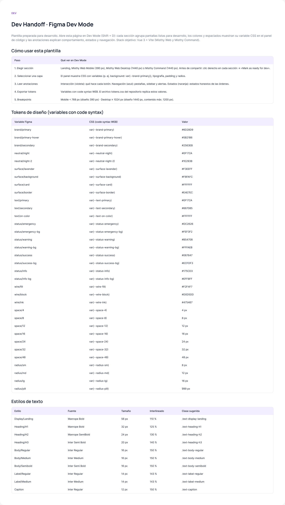</p>

<p align="center">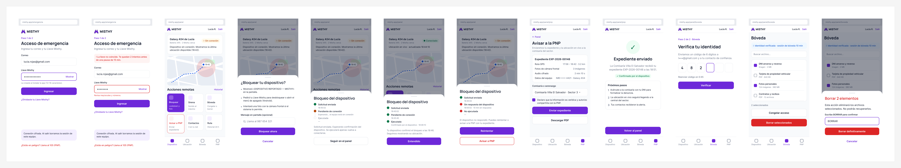</p>
